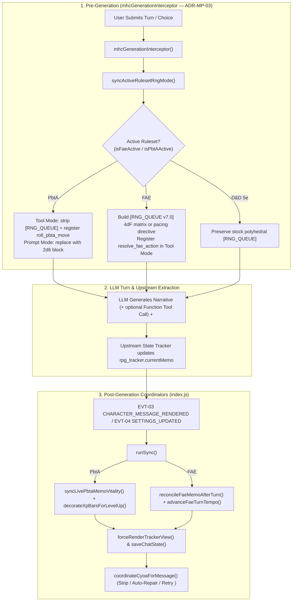

# MultiHog Companion — Ruleset Cartridges & Live Turn Engine Contracts

> **Purpose:** This folder documents the **executable architectural contracts** governing Ruleset Cartridges (`pbta`, `fae`, `dnd5e`), per-chat setup persistence and isolation, pre-generation RNG/Tool interception, post-turn State Memo reconciliation, and CYOA choice repair.  
> It applies the same contract-driven methodology as [docs/concierge/README.md](../concierge/README.md) to prevent regressions where prompt assembly, persistence hydration, and live turn execution drift apart.

---

## 1. Document Map (Cartridges & Live Turn Contracts)

| Phase / Document | Scope & Owned Subsystem | Primary Source Files |
| :--- | :--- | :--- |
| **[persistence-and-isolation.md](persistence-and-isolation.md)** | Cartridge compilation, `CompanionActiveCartridge` + `chatStates[chatId]` persistence, `doesLiveLibraryMatchCartridge()`, stock D&D cleansing, and cross-chat isolation (`CART-001` – `CART-003`) | `pbta-ruleset-persistence.js`, `index.js`, `history-integrity-guard.js` |
| **[pbta-cartridge-and-vitality.md](pbta-cartridge-and-vitality.md)** | PbtA genre/stats resolution, `maxHarmFate`, 2d6 moves/tool mode, tandem HP/Harm math, Harm rescaling, pill repair, Living World sync, and Companion bridge (`CART-004`, `CART-007`, `CART-008`) | `pbta-ruleset.js`, `concierge-system-pbta.js`, `pbta-vitality-sync.js`, `pbta-companion-bridge.js`, `level-up-runner.js` |
| **[fae-cartridge-and-attrition.md](fae-cartridge-and-attrition.md)** | FAE pool normalization, 4dF lookup matrix vs `resolve_fae_action` tool, Breaking Point clamp, Stage 2 overflow cascades, `advanceFaeTurnTempo()`, Living World merge, and `WRK-09` stripping (`CART-005`, `CART-006`, `CART-009`) | `fae-ruleset.js`, `concierge-system-fae.js`, `fae-state-sync.js`, `ruleset-rng-interceptor.js` |
| **[dnd5e-rng-and-cyoa-loop.md](dnd5e-rng-and-cyoa-loop.md)** | D&D 5e Lite adapter & live merge, Subfooter Alignment (`FEAT-09`), `mhcGenerationInterceptor` (`ADR-MP-03`) RNG/tool orchestration, and ruleset-aware CYOA choice repair (`FEAT-03`, `CART-010` – `CART-013`) | `concierge-system-dnd5e.js`, `dnd-fixes.js`, `ruleset-rng-interceptor.js`, `cyoa-safety-net.js`, `cyoa-generator.js`, `pbta-ruleset-persistence.js` |

*(See also: [ORIENTATION.md](../ORIENTATION.md), [listeners-and-lifecycle.md](../listeners-and-lifecycle.md), and [upstream-multihog.md](../upstream-multihog.md).)*

---

## 2. Three-Engine Architecture Comparison Matrix

| Dimension | **Powered by the Apocalypse (PbtA)** | **Freeform Attrition Engine (FAE)** | **D&D 5e Lite (Companion-Managed)** |
| :--- | :--- | :--- | :--- |
| **Cartridge ID & Snippet Prefix** | `pbta` (`pbta_base_override_*`, `pbta_campaign_*`, `pbta_custom_*`) | `fae` (`fae_base_override_*`, `fae_campaign_*`, `fae_custom_*`) | `dnd5e` (`mhc_dnd_*`, `dnd5e_campaign_*`, `dnd5e_custom_*`) |
| **Primary Ruleset & Adapter Modules** | `pbta-ruleset.js`, `concierge-system-pbta.js` | `fae-ruleset.js`, `concierge-system-fae.js` | `concierge-system-dnd5e.js`, `dnd-fixes.js` |
| **Core Resolution Mechanics** | 2d6 + Stat (-1 to +3): Miss (≤6), Weak Hit (7–9), Strong Hit (10+) | Single-pass 4dF (-4 to +4): `max(0, Threat + 4dF - PosTags + NegTags + Shift)` | Stock MultiHog polyhedral checks (d20/damage dice) with Concierge context |
| **Pre-Turn RNG Injection (`ADR-MP-03`)** | Prompt Mode: replaces polyhedral `[RNG_QUEUE]` with `2d6` rolls Tool Mode: strips `[RNG_QUEUE]` and registers `roll_pbta_move` | Prompt Mode: injects 4dF `[RNG_QUEUE]` + 5-row pre-computed matrix Tool Mode: removes combat queue, keeps pacing directive, registers `resolve_fae_action` | Preserves native MultiHog polyhedral `[RNG_QUEUE]` and native dice tool |
| **State Memo `[CHARACTER]` Schema** | Tandem HP/Harm (`cur/max HP \| Harm: cur/max \| Armor: N`), `Stats:`, `((PILLS)) Moves:`, `((PILLS)) Conditions:`, `XP: X/Y` | Line 1 Primary Pool (`cur/max HP \| Pool: Primary (cur/max) \| Scenes: X/Y \| XP: X/Y`), secondary `((BAR:color))` pools, `FAE Knobs:`, `((PILLS)) Positive Tags:`, `((PILLS)) Scars & Debuffs:` | Stock MultiHog `[CHARACTER]`, `[PARTY]`, `[SPELLS]`, `[XP]` blocks |
| **Post-Turn Reconciler** | `syncLivePbtaMemoVitality()` (enforces `HP = maxHarm - curHarm` tandem invariant & repairs malformed pill syntax) | `reconcileFaeMemoAfterTurn()` (tool stamp OR Stage 1 Breaking Point Clamp + Stage 2 Overflow cascade, `WRK-09` `[PARTY]` strip) + `advanceFaeTurnTempo()` | Native MultiHog State Tracker merge only |
| **Custom Genre Override Helper** | `resolveEffectivePbtaGenre(genreKey, overrides)` | `resolveEffectiveFaeGenre(genreKey, overrides)` + `normalizeCustomFaePools()` | Presets in `concierge-system-dnd5e.js` (`DND5E_GENRES`) |
| **Advancement / Level-Up Hook** | `XP >= max` triggers autonomous PbtA Level-Up Concierge modal (`FEAT-10`) | Scene Milestone every `scenes_target` scenes (Heal Scar / New Tag / +1 Max Pool) | Suppressed upstream protocol (`level_up_protocol: false`) in favor of `FEAT-10` |

---

## 3. End-to-End Live Turn Lifecycle

---

## 4. Standard 9-Section Cartridge & Live Turn Contract Template

Every subsystem contract document under `docs/cartridges/` uses these 9 sections:
1. **Subsystem Purpose & Ownership Boundary** — Clear line between Companion hooks/overrides and strictly read-only upstream `SillyTavern-MultihogDnDFramework/`.
2. **Cartridge Slot Map & `customModuleTag` Fingerprints** — Exact library snippet IDs, `baseTag` overrides, `origin` (`unlocked_base` vs `custom`), and `blockOrder` entries.
3. **Compilation & Override Resolution Contract** — Exact merge rules for `genreKey`, `overrides`, `dossier`, `config`, and Ruleset Architect `customGenreSpec`.
4. **Pre-Turn / Persistence Input Contract** — Data stored in `CompanionActiveCartridge`, `chatStates[chatId]`, or injected via `mhcGenerationInterceptor`.
5. **Post-Turn State Reconciliation Contract** — Deterministic math invariants, regex extraction boundaries, and pill syntax repair rules.
6. **Living World & Mid-Campaign Mutation Contract** — How `syncPbtaCampaignUpdates()` mutates live prompts and memos non-destructively without losing active play state.
7. **Chat-Switch & Reload Persistence Contract** — Exact hydration order under `runChatChangedCoordinator()`, `doesLiveLibraryMatchCartridge()`, and isolation guards.
8. **Failure Modes, Guardrails & Fallbacks** — Timeout guards, quarantine banners, unstarted chat protection, and mutexes (`_isSettingsSyncActive`).
9. **Code Anchors & Test Coverage** — Canonical function names, catalog tags (`FEAT-XX`, `WRK-XX`, `EVT-XX`, `ADR-MP-XX`), and automated test files.

---

## 5. Active Cartridges & Live Turn Audit Tracker

| Audit ID | Status | Severity | Summary of Defect & Fix / Planned Action | Verified By |
| :--- | :--- | :--- | :--- | :--- |
| **`CART-001`** | **Fixed (Phase 1)** | **High** | `resolveEffectivePbtaGenre()` ignored `overrides.dossier.meta.customGenreSpec`, `ensureActiveChatRulesetConsistency()` omitted `customGenreSpec`, `syncActiveRulesetRngMode()` stripped `customGenreSpec`/`dossier` on every outgoing turn, and `PbtaSystemAdapter.normalizeProtagonist()` ignored `customGenreSpec` stats/moves. Added `dossier.meta.customGenreSpec` fallback in `pbta-ruleset.js`, wired `customGenreSpec`/`dossier` through persistence hydration & `ruleset-rng-interceptor.js`, and used `resolveEffectivePbtaGenre()` in `concierge-system-pbta.js`. | `tests/cartridge-compiler-and-isolation.test.js` `tests/phase12-narrator-prompts.test.js` |
| **`CART-002`** | **Fixed (Phase 1)** | **High** | FAE lacked `resolveEffectiveFaeGenre()` / array-to-map pool normalizer for Ruleset Architect `customGenreSpec.pools`, `buildFaeStockPrompts()` / `buildFaeCombatContent()` / `buildFaeFooterContent()` / `createInitialFaeState()` read raw `FAE_GENRES[genreKey]`, and `syncActiveRulesetRngMode()` lost `heroicTier` when `memo` was empty before Turn 1. Added `normalizeCustomFaePools()` + `resolveEffectiveFaeGenre()` in `fae-ruleset.js`, wired into `concierge-system-fae.js`, `pbta-ruleset-persistence.js`, and `ruleset-rng-interceptor.js`. | `tests/cartridge-compiler-and-isolation.test.js` `tests/fae-integration.test.js` |
| **`CART-003`** | **Fixed (Phase 1)** | **Medium** | `applyRulesetCartridge()` did not persist `customGenreSpec`, `stats`, or `pools` on `CompanionActiveCartridge` when overrides arrived directly, and `doesLiveLibraryMatchCartridge()` did not detect missing `blockOrder` tags (`customModuleTag`). Persisted override metadata in `index.js` and added `blockOrder` completeness validation in `pbta-ruleset-persistence.js`. | `tests/cartridge-compiler-and-isolation.test.js` |
| **`CART-004`** | **Fixed (Phase 2)** | **Medium** | `mergeDossierIntoLiveMemo()` in `pbta-vitality-sync.js` omitted `[FACTIONS]` & `customModule` updates, only updated `Gear:` when matching `'Essential adventurer kit'`, and emitted `'++2'` on pre-prefixed stats. Added non-destructive `[FACTIONS]` & initial `[CUSTOM_MODULE]` merging, explicit `hasCustomGear` updates, and numeric stat normalization. | `tests/pbta-dossier-sync-nondestructive.test.js` |
| **`CART-005`** | **Fixed (Phase 3)** | **Medium** | `_lastFaeMemoByChat` started empty after F5 reload, causing Turn 1 post-reload FAE turns to miss Stage 1 Breaking Point Clamp and Stage 2 Overflow when upstream already updated `currentMemo`. Added `recordPreTurnFaeMemoBaseline()` / `getPreTurnFaeMemoBaseline()` in `ruleset-rng-interceptor.js` seeded in `mhcGenerationInterceptor()`, `hydratePbtaMemoIfNeeded()`, and `runSync()` (`index.js`). | `tests/fae-concierge-sync.test.js` |
| **`CART-006`** | **Fixed (Phase 3)** | **Medium** | FAE Stage 2 Overflow `redirect:<pool>` in `handleOverflow()` (`fae-ruleset.js`) threw on case mismatch and `reconcileFaeMemoAfterTurn()` (`fae-state-sync.js`) silently dropped attrition when `targetKey` was absent in custom 2-pool geometries. Added normalized/label matching + sibling-pool & `scar_and_ko` fallback cascades. | `tests/fae-engine.test.js` |
| **`CART-007`** | **Fixed (Phase 2)** | **Medium** | `formatInitialPbtaMemo()` emitted empty `Stats:` on `{}` / hardcoded Fantasy fallbacks instead of `resolveEffectivePbtaGenre()`, and `buildPbtACombatContent()` / `buildPbtACyoaPrompt()` / `buildPbtAStockPrompts()` ignored `customGenreSpec.maxHarmFate`. Added `resolveEffectiveMaxHarmFate()` and wired `resolveEffectivePbtaGenre()` into initial memo & quick-start compilation in `pbta-ruleset.js`. | `tests/pbta-dossier-sync-nondestructive.test.js` |
| **`CART-008`** | **Fixed (Phase 2)** | **Low** | `detectActiveGenre()` prioritized global `extSettings.lastGenre` before per-chat `CompanionActiveCartridge` / dossier, and `buildTailoredPbtaDocumentation()` bypassed `resolveEffectivePbtaGenre()` for custom rulesets. Aligned per-chat precedence and wired `resolveEffectivePbtaGenre()` in `pbta-companion-bridge.js`. | `tests/pbta-companion-bridge.test.js` |
| **`CART-009`** | **Fixed (Phase 3)** | **High** | `formatInitialFaeMemo()` ignored `dossier.meta.systemKey` & `customGenreSpec`, and `mergeDossierIntoLiveFaeMemo()` fell back to raw `FAE_GENRES` instead of `resolveEffectiveFaeGenre()` and omitted `worldRules.customModule` seeding (`fae-state-sync.js`). Added `meta.systemKey` lookup, `normalizeCustomFaePools()`, and `[CUSTOM_MODULE]` seeding. | `tests/fae-concierge-sync.test.js` |
| **`CART-010`** | **Fixed (Phase 4)** | **Medium** | `_getSettings()` in `cyoa-safety-net.js` read wrong key `MultiHogCompanion` instead of `multihog_companion`, and `isCyoaExpected()` / `coordinateCyoaForMessage()` omitted `isFaeActive()` checks (falling into D&D mode for FAE chats). Fixed settings key lookup order and wired FAE detection through `isCyoaExpected()`, `isProtagonistDowned()`, and `generateCyoaChoices()`. | `tests/cyoa-safety-net.test.js` |
| **`CART-011`** | **Fixed (Phase 4)** | **High** | `buildCyoaPrompt()` in `cyoa-generator.js` indexed raw `FAE_GENRES` / `PBTA_GENRES` via non-existent `rpgSettings.faeGenre`/`pbtaGenre` keys instead of per-chat `CompanionActiveCartridge` & dossier, ignoring `customGenreSpec` and custom PbtA `maxHarmFate`. Added `resolveCyoaChatOverrides()` wired into `resolveEffectiveFaeGenre()`, `resolveEffectivePbtaGenre()`, and `resolveEffectiveMaxHarmFate()`. | `tests/cyoa-generator.test.js` |
| **`CART-012`** | **Fixed (Phase 4)** | **Medium** | `Dnd5eSystemAdapter.formatInitialMemo()` hardcoded `Level: 1` / `HD: (1/1)` and omitted `[FACTIONS]` & custom HUD blocks, while `mergeLiveMemo()` was a no-op stub (`concierge-system-dnd5e.js`). Wired `XP_LEVEL_THRESHOLDS`, `[FACTIONS]`, and `formatDndCustomModuleSeed()` into initial/live D&D memos. | `tests/concierge-system-dnd5e.test.js` |
| **`CART-013`** | **Fixed (Phase 4)** | **Medium** | `cleanseStockDndSettings()` let upstream `factory.syspromptModules` overwrite `level_up_protocol: false` (`FEAT-10`) and wiped aligned D&D `cyoaConfig`; `applyDndSubfooterAlignment()` omitted `syspromptSnippetDatabase` mirroring; `ensureActiveChatRulesetConsistency()` omitted `activeCart.dossier` fallback. Fixed preservation, dual-catalog mirroring (`WRK-09`), and D&D snippet hydration. | `tests/dnd-subfooter-alignment.test.js` |
