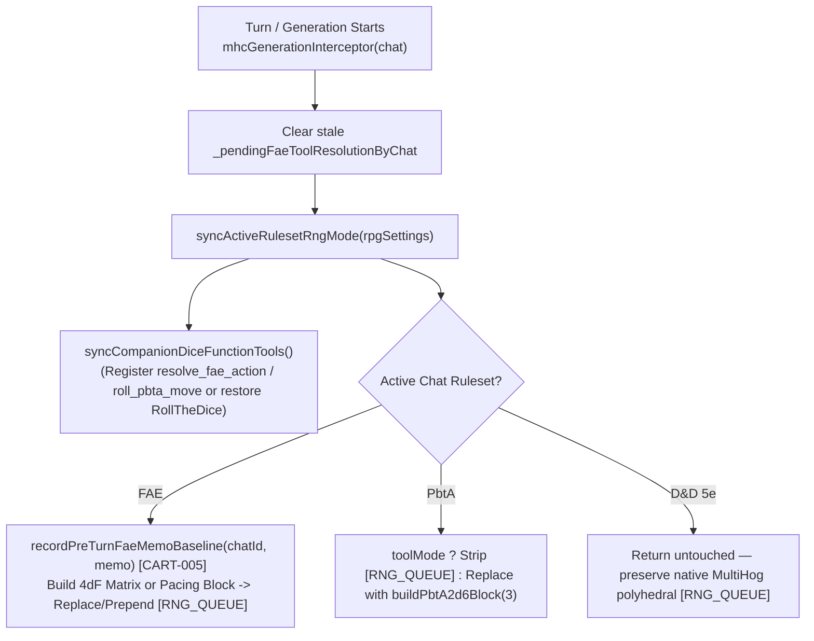

# Contract Sheet: D&D 5e Lite Adapter, RNG Interceptor & CYOA Choice Loop

> **Phase:** 4 — D&D 5e Lite Cartridge Framing, Subfooter Alignment, Pre-Turn RNG Interception & Ruleset-Aware CYOA Choice Repair  
> **Primary Code:** [concierge-system-dnd5e.js](../../concierge-system-dnd5e.js), [dnd-fixes.js](../../dnd-fixes.js), [ruleset-rng-interceptor.js](../../ruleset-rng-interceptor.js), [cyoa-safety-net.js](../../cyoa-safety-net.js), [cyoa-generator.js](../../cyoa-generator.js), [pbta-ruleset-persistence.js](../../pbta-ruleset-persistence.js)  
> **Related Catalog Entries:** `FEAT-01`, `FEAT-02`, `FEAT-03`, `FEAT-09`, `FEAT-10`, `WRK-03`, `WRK-07`, `WRK-08`, `WRK-09`, `EVT-04`, `EVT-05`, `EVT-08`, `EVT-09`, `EVT-10`, `DOM-06`, `DOM-07`, `ADR-MP-03`

---

## 1. Subsystem Purpose & Ownership Boundary

MultiHog's native substrate is D&D 5e. Rather than replacing the entire engine for standard d20 campaigns, Companion layers four lightweight, ruleset-aware subsystems on top of upstream without mutating upstream files:

* **D&D 5e (D&D Lite) Concierge Adapter (`concierge-system-dnd5e.js`):** Streamlines character creation around single-track 1–20 class progressions (`CORE_DND_PROGRESSIONS`), deterministic Hit Die / modifier / HP / AC math, dual-block trait routing (passive traits vs. rest-counter abilities), inventory normalization, Day 0 memo synthesis, and per-chat campaign framing (`<tone>`, `<factions>`, `<world_rules>`, custom HUD blocks).
* **Subfooter Alignment & Deft Touch Pacing (`dnd-fixes.js`, `FEAT-09`):** Resolves two native D&D UX conflicts via declarative settings overrides — unifying `<end_of_output_footer>` + `<CYOA_mode>` into a strict subfooter order without prompt leakage when CYOA is off, and granting outside-combat narrative-first pacing via `<deft_touch_pacing>`.
* **Pre-Generation RNG Interceptor Pipeline (`ruleset-rng-interceptor.js`, `ADR-MP-03`):** Executes SillyTavern's `generate_interceptor` (`mhcGenerationInterceptor`, manifest `loading_order: 30` after MultiHog's `20`) to synchronize function tools (`resolve_fae_action`, `roll_pbta_move`, or stock `RollTheDice`), align active ruleset RNG sysprompt snippets, seed pre-turn FAE baselines, and rewrite `[RNG_QUEUE]` on outgoing prompts.
* **Ruleset-Aware CYOA Safety Net & Generator (`cyoa-safety-net.js`, `cyoa-generator.js`, `FEAT-03`):** Provides zero-token local auto-repair from plain numbered markdown to interactive `<choices><button>...</button></choices>` markup, DOM split repair (`splitMixedFooterAndChoicesInDOM()`), slash commands (`/cyoagen`, `/cyoafix`, `/cyoaretry`), Wand repair/reroll trigger (`DOM-07`), and ruleset-aware crisis/tactical generation for FAE, PbtA, and D&D 5e.

**Upstream Boundary (Read-Only):**
* Upstream `SillyTavern-MultihogDnDFramework/` modules (`constants.js`, `defaults.js`, `narrative-hooks.js`, `src/app/runtime-bridge.js`, `src/state/chat-setup.js`) remain strictly untouched. Companion customizes D&D behavior exclusively through `customSyspromptLibrary`, `syspromptSnippetDatabase`, `syspromptModules`, `cyoaConfig`, `CompanionActiveCartridge`, and post/pre-turn hooks.

---

## 2. D&D 5e Lite Adapter & 1–20 Progression Codex

Implemented in `Dnd5eSystemAdapter` ([concierge-system-dnd5e.js](../../concierge-system-dnd5e.js)) backed by [level-up-blueprint.js](../../level-up-blueprint.js) (`FEAT-02`, `FEAT-10`):

1. **Deterministic Normalization (`normalizeProtagonist()`):**
   * Derives canonical Hit Die via `deriveHitDieForClass()` (`d12` Barbarian; `d10` Fighter/Paladin/Ranger; `d6` Wizard/Sorcerer; `d8` others).
   * Clamps 6 core ability scores (`STR`, `DEX`, `CON`, `INT`, `WIS`, `CHA`) to `3–20` and computes modifiers strictly via `calculateDndModifier()` (`Math.floor((score - 10) / 2)`).
   * Enforces Level 1 max HP `Math.max(1, hitDieSides + conMod)` and AC floor `10 + Math.max(0, dexMod)`.
   * Seeds Level 1 spell slots (`{ 1: 2 }` full casters, `{ 1: 1 }` Warlock) and links `CORE_DND_PROGRESSIONS` when matching a core class.
   * Partitions features via `partitionFeaturesAndAbilities()` into passive `protagonist.features` (`Traits:`) vs. rest-counter `protagonist.abilities` (`[ABILITIES]`).
2. **Level-Aware Day 0 Memo & Custom Framing (`formatInitialMemo()`, `CART-012`):**
   * Formats `[TIME]`, `[LOCATION]`, `[CHARACTER]`, `[ABILITIES]`, optional `[SPELLS]`, `[XP]`, `[INVENTORY]` (`normalizeDndInventoryLines()` grouping equipped gear vs. supplies/`💰 X GP`), plus optional `[FACTIONS]` (`formatFactionsMemoBlock()`) and `[<CUSTOM_TAG>]` (`formatDndCustomModuleSeed()`).
   * Uses `level = Math.max(1, parseInt(p.level, 10) || 1)` with `XP_LEVEL_THRESHOLDS` (`MAX_CHARACTER_LEVEL = 20`) so `HD: ${hitDie} (${level}/${level})` and `Level: ${level} | XP: ${curXp}/${nextXp}` match protagonist level (`Level: 1 | XP: 0/300` at Level 1).
3. **Cartridge Installation & Cleansing (`installCartridge()`):**
   * Calls `cleanseStockDndSettings(s, { chatId, syncSetup: false })`, applies `applyDndSubfooterAlignment()`, disables narrative-halting `syspromptModules.level_up_protocol = false` (`FEAT-10`), removes prior `dnd5e_campaign_*` / `dnd5e_custom_*` snippets, injects per-chat `buildCampaignContextSnippets('dnd5e', ...)` entries into both `customSyspromptLibrary` and `syspromptSnippetDatabase`, registers `customModuleTag` in `blockOrder`, stamps `CompanionActiveCartridge` (`cartridgeId: 'dnd5e'`), and saves via `persistPbtaChatState()`.

---

## 3. D&D Subfooter Alignment & Deft Touch Pacing (`FEAT-09`, `CART-013`)

Implemented in [dnd-fixes.js](../../dnd-fixes.js) and preserved across chat switches by [pbta-ruleset-persistence.js](../../pbta-ruleset-persistence.js):

| Override Component | Identifier / Flag | Storage & Behavior |
| :--- | :--- | :--- |
| **Footer Override (`unlocked_base`)** | `DND_SUBFOOTER_OVERRIDE_ID` (`mhc_dnd_subfooter_override_footer`) | Overrides `end_of_output_footer`; ends with `(followed only by any active subfooters explicitly defined elsewhere in your instructions)` with zero mention of "CYOA", "choices", or "button" so CYOA-off turns have zero prompt leakage. |
| **Deft Touch Pacing (`custom`)** | `DND_DEFT_TOUCH_OVERRIDE_ID` (`mhc_dnd_deft_touch_pacing`) | Grants permission outside combat not to force d20 skill checks on mundane dialogue/exploration and isolates mechanics from story prose. |
| **Aligned CYOA Subfooter** | `rpgSettings.cyoaConfig` | Sets `useCustomPrompt = true` and `customPromptText = getDndAlignedCyoaPrompt(slotCount)` declaring `[SUBFOOTER: INTERACTIVE CHOICES]` and strict sequence `(1) Scene -> (2) Status footer -> (3) <choices>`. |
| **Dual-Catalog Mirroring (`CART-013`)** | `syspromptSnippetDatabase` (`WRK-09`) | Both `DND_SUBFOOTER_OVERRIDE_ID` and `DND_DEFT_TOUCH_OVERRIDE_ID` include `scope: 'chat'` and `_chatSetupMember: true` and are mirrored into (and removed from) both `customSyspromptLibrary` and `syspromptSnippetDatabase` in `applyDndSubfooterAlignment()` and `revertDndSubfooterAlignment()`. |
| **Cleansing Shield (`CART-013`)** | `cleanseStockDndSettings()` | Enforces `level_up_protocol: false` after spreading upstream `factory.syspromptModules`, and preserves aligned `cyoaConfig` whenever `DND_SUBFOOTER_OVERRIDE_ID` remains enabled in `customSyspromptLibrary`. When switching to a D&D chat, `ensureActiveChatRulesetConsistency()` resolves campaign snippets from `dndDossier || activeCart?.dossier`. |

---

## 4. Pre-Generation RNG Interceptor Pipeline (`ADR-MP-03`)

Registered globally via `manifest.json` (`"generate_interceptor": "mhcGenerationInterceptor"`, `"loading_order": 30`), implemented in [ruleset-rng-interceptor.js](../../ruleset-rng-interceptor.js):

* **`syncActiveRulesetRngMode(rpgSettings)` Contract:**
  * Resolves authoritative `activeChatId` via `resolveAuthoritativeChatId()`.
  * **FAE:** Pulls `customGenreSpec`, `heroicTier` (`faeState.knobs`, `dossier.config`, `activeCart.config/knobs`), and `toolMode = Boolean(s.diceFunctionTool)` to keep `fae_base_override_rng` and `fae_base_override_role` synced in both `customSyspromptLibrary` and `syspromptSnippetDatabase`.
  * **PbtA:** Pulls `genreKey`, custom 3+ `stats`, `systemLabel`, `customGenreSpec`, and `dossier` (`CART-001`) to sync `pbta_base_override_rng` and `pbta_base_override_role`.
  * Calls `syncCompanionDiceFunctionTools()` so `resolve_fae_action` or `roll_pbta_move` is registered whenever `rngEnabled !== false && toolMode === true`, and unregistered (restoring native `RollTheDice` tools) otherwise.

---

## 5. Post-Turn CYOA Safety Net & Repair Loop (`FEAT-03`)

Implemented in [cyoa-safety-net.js](../../cyoa-safety-net.js):

1. **Expectation Gate (`isCyoaExpected(rpgSettings, isPbtaActive, isFaeActiveFlag)`, `CART-010`):**
   * Returns `false` if `!rpgSettings || rpgSettings.enabled === false` or `rpgSettings.cyoaConfig?.playstyle === 'freeform'`.
   * For both PbtA (`isPbtaActive`) and FAE (`isFaeActiveFlag || isFaeActive()`), expects CYOA by default unless `syspromptModules?.CYOA_mode === false`.
   * For D&D 5e, requires `syspromptModules?.CYOA_mode === true`.
   * Default `_getSettings()` reads `extensionSettings.multihog_companion` first (falling back to legacy `MultiHogCompanion`) so Companion settings (`enableDecoupledCyoa`, `cyoaMaxTokens`, `enableFastPipeline`) are always honored (`CART-010`).
2. **Unified 3-Tier Dispatcher (`coordinateCyoaForMessage()`):**
   * **Pre-Flight Shields:** Skips if narrator is streaming (`CHARACTER_MESSAGE_RENDERED`), generation was stopped (`_wasGenerationStopped`, reset on `GENERATION_STARTED` `EVT-09` unless `force: true`), message is non-narrator / tool call card, `isLevelUpPending(msg.mes)` (`WRK-08`), or `isProtagonistDead(freshMemo)` (`WRK-08`).
   * **Tier 1 — Happy Path & Downed Validation:** When `hasCyoaChoices(msg.mes)` is true, runs `ensureBlankLineBeforeChoices()` to separate collapsed footers from `<choices>`. Checks `isProtagonistDowned(freshMemo, pbtaActive, faeActive)`; if downed choices lack crisis wording, falls through to Tier 3 to regenerate survival options.
   * **Tier 2 — Zero-Token Local Regex Repair:** Calls `tryRepairMarkdownChoices()` + `applyRepairedMessage()` (converting trailing numbered/bulleted lists beneath `"What do you do?"` into `<choices><button>...</button></choices>` and invoking `splitMixedFooterAndChoicesInDOM()` + `_rpgFinalizeCyoaNarratorRender()`).
   * **Tier 3 — Routed LLM Generation:** Invokes `generateCyoaChoices()` with `{ isPbta: faeActive ? false : pbtaActive, isFae: faeActive }`.
3. **Interactive Entrypoints (`DOM-07` & Slash Commands):**
   * Wand button `#mhc_wand_cyoa_fix_reroll` (`DOM-07`) runs `handleWandCyoaFixOrReroll()` on the latest settled narrator message (`tryRepairMarkdownChoices()` fast path or `regenerateCyoaChoicesForMessage()` with `force: true`).
   * Slash commands `/cyoagen`, `/cyoaretry`, and `/cyoafix` invoke `regenerateCyoaChoicesForMessage()` / `repairOrGenerateChoicesForMessage()`.

---

## 6. Ruleset-Aware CYOA Prompt Builder & Token Budgeting (`cyoa-generator.js`)

Implemented in [cyoa-generator.js](../../cyoa-generator.js) (`CART-011`):

1. **Per-Chat Context Resolution (`resolveCyoaChatOverrides(rpgSettings, chatId)`):**
   * Inspects active chat `CompanionActiveCartridge` and `chatStates[chatId]` partition dossier to extract `genreKey`, `systemLabel`, `customGenreSpec`, custom 3+ `stats`, custom `pools`, `heroicTier`, `heroicDomain`, and `config` (`maxHarmFate`).
2. **Engine-Specific Prompt Contracts (`buildCyoaPrompt()`):**
   * **FAE Mode (`effectiveIsFae`):** Resolves `genre = resolveEffectiveFaeGenre(genreKey, chatOverrides)` and extracts active pool names from `[CHARACTER]` (`Pool:` and `((BAR...))` supporting hyphens/apostrophes/slashes) or `genre.pools`. Emits Style B rules (`— [Pool | +Tag1]` / `— [Pool]` / bare zero-roll actions, banning D&D DCs and PbtA move names), Heroic Tier guidance when `heroicTier` is enabled, or 0-HP Breaking Point survival choices (`FLEE GRACE`, `PIVOT TO SECONDARY POOL`, `BRACE FOR OVERFLOW`, `COLLAPSE / SUCCUMB`).
   * **PbtA Mode (`isPbta`):** Resolves `genre = resolveEffectivePbtaGenre(genreKey, chatOverrides)` so prompt includes active custom/preset `genre.stats`, 2d6 move/Hold/dilemma guidance (banning DCs and advantage/disadvantage), and adapts downed/Max Harm prompts via `resolveEffectiveMaxHarmFate(chatOverrides, genre)` (`respawn`, `burnout`, or custom crisis rule vs. default `LAST BREATH`).
   * **D&D 5e Mode:** Emits tactical `[Attack (+X) vs AC Y]` / `[Investigation (+X) DC Y]` / `[No roll]` prompt rules, or Death Saving Throw crisis options at `<= 0 HP` / unconscious.
3. **Token Budgeting & UI Locking (`resolveCyoaMaxTokens()`, `WRK-07`):**
   * Precedence: explicit `cyoaMaxTokens` override -> dedicated connection `maxTokens` (returns `0` to delegate to profile preset) -> active preset `openai_max_tokens` / `amountGen` -> dynamic headroom from `contextLimit - estimatedPromptTokens - 256` with `4096` floor on `>= 8192` contexts.
   * Locks `#send_but` (`lockSendButtonUI()`), renders `.mhc-cyoa-loading-badge` with a cancel button (`insertCyoaLoadingIndicator()`), and cleans up reliably in `finally` or on `CHAT_CHANGED` (`EVT-05`), `GENERATION_STARTED` (`EVT-09`), `GENERATION_STOPPED` (`EVT-10`, `WRK-07`), and Stop clicks (`DOM-06`).

---

## 7. Living World D&D 5e Mutation Contract (`CART-012`)

`Dnd5eSystemAdapter.mergeLiveMemo(liveMemo, dossier, charName)` updates an active D&D campaign memo non-destructively while preserving live HP, combat enemies, location, time, XP, and inventory:
1. Updates `Traits:` inside `[CHARACTER]...[/CHARACTER]` from formatted `dossier.protagonist.features` pills if non-empty (inserting `Traits:` before `[/CHARACTER]` if missing).
2. Replaces (or appends) `[ABILITIES]...[/ABILITIES]` from `dossier.protagonist.abilities` if non-empty.
3. Replaces (or appends) `[FACTIONS]...[/FACTIONS]` via shared `formatFactionsMemoBlock(dossier.factions)`.
4. Appends `[<CUSTOM_TAG>]...[/<CUSTOM_TAG>]` via `formatDndCustomModuleSeed(dossier)` when newly enabled and not yet present in `liveMemo`.

---

## 8. Failure Modes, Guardrails & Known Findings Remediated (`CART-010` – `CART-013`)

| Failure Mode / Audit ID | Guardrail / Remediation Applied |
| :--- | :--- |
| `_getSettings()` in `cyoa-safety-net.js` read `MultiHogCompanion` instead of `multihog_companion`, and FAE chats fell into D&D `isCyoaExpected()` logic (`CART-010`) | Default `_getSettings()` now prioritizes `extensionSettings.multihog_companion`; `isCyoaExpected()` and `coordinateCyoaForMessage()` detect and forward `isFaeActive()`. |
| `buildCyoaPrompt()` in `cyoa-generator.js` ignored `CompanionActiveCartridge`, partition dossier, `customGenreSpec`, FAE custom pools/heroicTier, and custom PbtA `maxHarmFate` (`CART-011`) | Added `resolveCyoaChatOverrides()` wired into `resolveEffectiveFaeGenre()`, `resolveEffectivePbtaGenre()`, and `resolveEffectiveMaxHarmFate()` (including downed `respawn`/`burnout`/custom rules). |
| `Dnd5eSystemAdapter.formatInitialMemo()` hardcoded `Level: 1` / `HD: (1/1)` and omitted `[FACTIONS]` / `[<CUSTOM_TAG>]`; `mergeLiveMemo()` was a no-op stub (`CART-012`) | Wired `XP_LEVEL_THRESHOLDS`, level-scaled `HD`, `formatFactionsMemoBlock()`, and `formatDndCustomModuleSeed()` into `formatInitialMemo()` and implemented non-destructive `mergeLiveMemo()`. |
| `cleanseStockDndSettings()` allowed `factory.syspromptModules` to re-enable `level_up_protocol: true` and cleared aligned D&D `cyoaConfig`; `applyDndSubfooterAlignment()` omitted `syspromptSnippetDatabase` mirroring (`CART-013`) | Enforced `level_up_protocol: false` after factory spread, preserved aligned `cyoaConfig` when `DND_SUBFOOTER_OVERRIDE_ID` is enabled, mirrored D&D fix snippets into `syspromptSnippetDatabase`, and added `activeCart.dossier` fallback in `ensureActiveChatRulesetConsistency()`. |

---

## 9. Code Anchors & Test Coverage

* **Primary Implementation:**
  * `concierge-system-dnd5e.js`: `DND5E_GENRES`, `calculateDndModifier`, `normalizeDndInventoryLines`, `formatDndCustomModuleSeed`, `Dnd5eSystemAdapter` (`normalizeProtagonist`, `formatInitialMemo`, `mergeLiveMemo`, `installCartridge`).
  * `dnd-fixes.js`: `DND_SUBFOOTER_OVERRIDE_ID`, `DND_DEFT_TOUCH_OVERRIDE_ID`, `getDndDeftTouchPacingContent`, `getDndAlignedFooterContent`, `getDndAlignedCyoaPrompt`, `applyDndSubfooterAlignment`, `revertDndSubfooterAlignment`.
  * `ruleset-rng-interceptor.js`: `rollD6`, `buildPbtA2d6Block`, `syncCompanionDiceFunctionTools`, `syncActiveRulesetRngMode`, `mhcGenerationInterceptor`, `recordPreTurnFaeMemoBaseline`, `getPreTurnFaeMemoBaseline`.
  * `cyoa-safety-net.js`: `isCyoaExpected`, `isLevelUpPending` (`WRK-08`), `tryRepairMarkdownChoices`, `splitMixedFooterAndChoicesInDOM`, `coordinateCyoaForMessage`, `initCyoaSafetyNet`, `regenerateCyoaChoicesForMessage`, `repairOrGenerateChoicesForMessage`, `registerCyoaSlashCommands`, `handleWandCyoaFixOrReroll`.
  * `cyoa-generator.js`: `isProtagonistDowned`, `buildCyoaPrompt`, `extractChoicesMarkup`, `resolveCyoaMaxTokens`, `extractTextFromApiResponse`, `generateCyoaChoices`, `abortCyoaGeneration`.
  * `pbta-ruleset-persistence.js`: `cleanseStockDndSettings`, `ensureActiveChatRulesetConsistency`.
* **Regression Suites:**
  * `tests/concierge-system-dnd5e.test.js` — D&D 5e adapter math, feature/ability partitioning, initial memo, and `CART-012` live merge/custom block/level scaling.
  * `tests/dnd-subfooter-alignment.test.js` — Subfooter contract, zero-leakage guard, `CART-013` dual-catalog mirroring, and `cleanseStockDndSettings()` preservation.
  * `tests/stock-dnd-sanitization.test.js` — `cleanseStockDndSettings()`, D&D isolation on blank/D&D chat switch.
  * `tests/cyoa-safety-net.test.js` & `tests/cyoa-edge-cases.test.js` — Blank-line separation, DOM footer split, `WRK-08` shield, `CART-010` settings key & FAE expectation.
  * `tests/cyoa-generator.test.js` & `tests/pbta-move-guidance-dnd-suppression.test.js` — Downed detection, token budgeting, reasoning extraction, and `CART-011` per-chat cartridge / custom `maxHarmFate` prompts.
