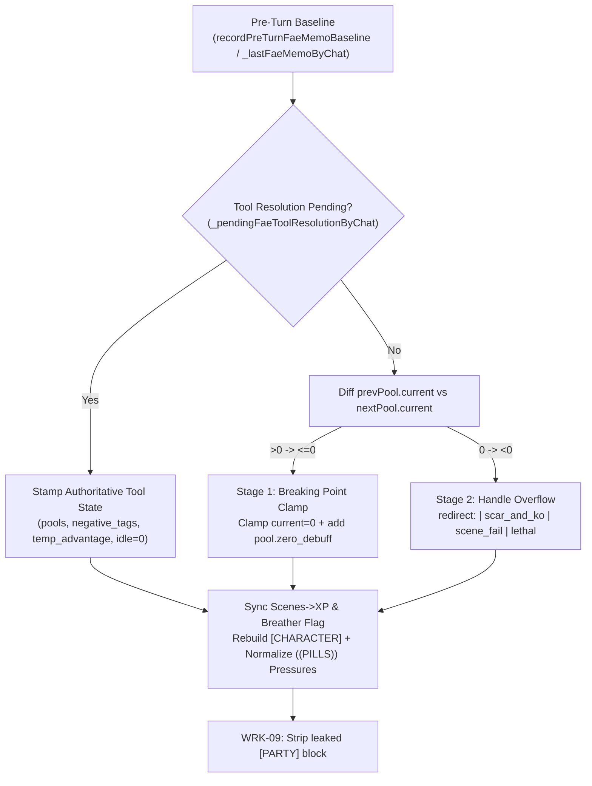

# Contract Sheet: FAE 4dF Cartridge, Attrition Engine & Turn Tempo

> **Phase:** 3 — FAE 4dF Cartridge Compilation, Lookup Matrix vs Function Tool, Breaking Point/Overflow & Turn Tempo  
> **Primary Code:** [fae-ruleset.js](../../fae-ruleset.js), [concierge-system-fae.js](../../concierge-system-fae.js), [fae-state-sync.js](../../fae-state-sync.js), [ruleset-rng-interceptor.js](../../ruleset-rng-interceptor.js)  
> **Related Catalog Entries:** `FEAT-03`, `FEAT-06`, `WRK-09`, `EVT-03`, `EVT-04`, `ADR-MP-01`, `ADR-MP-03`

---

## 1. Subsystem Purpose & Ownership Boundary

The **Freeform Attrition Engine (FAE)** replaces binary pass/fail skill checks and D&D combat action economy with single-pass forward momentum measured by **Resource Pool Attrition** on a `4dF` (`-4` to `+4`) bell curve. MultiHog's upstream State Tracker (`renderer.js`, `portraits.js`, `memo-processor.js`) expects standard `[CHARACTER]` health-bar lines and progress bars (`((BAR:color))`), and upstream's `mergeMemo` unconditionally appends `[PARTY]` even when `modules.party` is `false` (`WRK-09`).

**Companion Ownership:**
* **Cartridge, 4dF Engine & Overflow State Machine (`fae-ruleset.js`, `concierge-system-fae.js`):** Defines `FAE_GENRES` presets, `resolveEffectiveFaeGenre()` / `normalizeCustomFaePools()` for Ruleset Architect custom specs, `TEMPO_WINDOWS` pacing logic, `roll4dF()`, `buildFaeRngBlock()` (5-row pre-computed matrix), `resolveAction()`, `handleOverflow()`, `triggerEventOrRest()`, and `executeFaeActionTool()`.
* **Post-Turn Reconciliation & State Sync (`fae-state-sync.js`):** Formats `[CHARACTER]` and initial FAE memos (`formatFaeCharacterMemoBlock()`, `formatInitialFaeMemo()`), parses `[CHARACTER]`/`[COMBAT]` back into structured state (`parseFaeStateFromMemo()`), enforces Stage 1 Breaking Point Clamp and Stage 2 Overflow (`reconcileFaeMemoAfterTurn()`), advances dynamic tempo (`advanceFaeTurnTempo()`), strips leaked `[PARTY]` blocks (`stripFaePartyBlockFromMemo()`, `WRK-09`), and supports non-destructive Living World updates (`mergeDossierIntoLiveFaeMemo()`).
* **Pre-Turn Baseline & Interceptor (`ruleset-rng-interceptor.js`, `index.js`):** Replaces `[RNG_QUEUE]` with the 4dF lookup matrix (or pacing directive in tool mode), registers `resolve_fae_action`, and captures pre-turn baselines (`recordPreTurnFaeMemoBaseline()`) so F5 reloads never bypass Breaking Point or Overflow checks (`CART-005`).

**Upstream Boundary (Read-Only):**
* Upstream `renderer.js`, `portraits.js`, `memo-processor.js`, and `narrative-hooks.js` remain unmodified.

---

## 2. Cartridge Slot Map & `customModuleTag` Fingerprints

`buildFaeCartridge(genreKey, overrides)` emits the following library snippets and `blockOrder`:

| Snippet ID | Tag | `origin` | Purpose |
| :--- | :--- | :--- | :--- |
| `fae_base_override_role` | `role` | `unlocked_base` | Single-pass resolution, Two-Tier Strain vs Trauma narration, Heroic Domains (`HEROIC DOMAINS`) |
| `fae_base_override_rng` | `rng_system` | `unlocked_base` | `4dF` attrition formula & lookup matrix rules OR `resolve_fae_action` function tool instructions |
| `fae_base_override_combat` | `combat` | `unlocked_base` | Unified 4-line Encounter Block (`X/Y HP \| Threat: N \| Pools: ...`), Barriers, +/-1 Threat cap |
| `fae_base_override_ruleset_note` | `ruleset_note` | `custom` | Orderable `<ruleset_note>` reminder before `<constraints>` |
| `fae_base_override_footer` | `end_of_output_footer` | `unlocked_base` | Exact two-line footer showing active resource pools, `Scenes: cur/target`, Location, Time |
| `fae_base_override_xp` | `xp_system` | `unlocked_base` | Scene Milestone Advancement every 3–5 completed scenes (`Heal Scar`, `New Tag`, `+1 Max Pool`) |
| `fae_base_override_party` | `[PARTY]_mechanics` | `unlocked_base` | Zero-Bookkeeping Companion model (`Companion:` / `Retainer:` Positive Tags) |
| `fae_base_override_state_memo` | `state_memo` | `unlocked_base` | `TRACKER STATE 0` authority & Zero-Pool action permission rule |
| `fae_base_override_constraints` | `constraints` | `unlocked_base` | 2-Tag stacking cap, Zero-State rule, Tier A/B Trait Qualification Protocol |
| `fae_campaign_tone`, `fae_campaign_factions`, `fae_custom_world_rules` | `tone` / `factions` / `world_rules` | `custom` | Campaign framing snippets via `buildCampaignContextSnippets()` |

* **Default `blockOrder`:** `['COMBAT', 'CHARACTER', 'INVENTORY', 'ABILITIES', 'TIME']` (plus optional `customModuleTag`). Note `PARTY` and `XP` are omitted (`modules.party = false`, `modules['benched party'] = false`, `modules.xp = false`).

---

## 3. Compilation & Override Resolution Contract (`CART-009`)

1. **Genre & Custom Pool Resolution (`resolveEffectiveFaeGenre` & `normalizeCustomFaePools` in `fae-ruleset.js`):**
   * Checks `overrides?.customGenreSpec || overrides?.meta?.customGenreSpec || overrides?.dossier?.meta?.customGenreSpec`.
   * Converts Ruleset Architect `spec.pools` (Array or Object) into normalized `Record<string, FaePool>` entries with stable `snake_case` keys and color cycling (`green`, `purple`, `amber`, `cyan`).
   * Used consistently across `buildFaeCartridge()`, `buildFaeStockPrompts()`, `buildFaeCombatContent()`, `buildFaeFooterContent()`, `buildFaeCyoaPrompt()`, `createInitialFaeState()`, `formatInitialFaeMemo()`, and `mergeDossierIntoLiveFaeMemo()` (`CART-009`).
2. **Initial Memo Compilation (`formatInitialFaeMemo(faeStateOrGenreKey, options)`):**
   * Resolves `genreKey` across `genreKey`, `meta?.systemKey`, `config?.genre`, `config?.faeGenre`, `genre`, and `options.genreKey` so Session Zero FAE dossiers at `dossier.meta.systemKey` never fall back to `'cosmic_horror'` (`CART-009`).
   * Synchronizes Line 1 `cur/max HP` with `Pool: Primary (cur/max)` and emits secondary pools with `((BAR:color))`.
3. **Knobs & Tempo Windows:**
   * `knobs`: `flee_grace_toggle` (`ON`/`OFF`), `base_attrition_shift` (`-1` Pulp, `0` Gritty, `+1` Brutal), `overflow_default`, `action_tempo` (`TEMPO_WINDOWS`: `action_serial` `2t`, `gritty_default` `3t`, `slow_burn` `5t`, `cinematic_calm` `999t`), `heroic_tier` (`ON`/`OFF`).

---

## 4. Pre-Turn Generation & 4dF Resolution Contract (`CART-005`)

Managed in [ruleset-rng-interceptor.js](../../ruleset-rng-interceptor.js) via `mhcGenerationInterceptor()` (`ADR-MP-03`):
* **Pre-Turn Baseline Capture (`CART-005`):**
  * Immediately records `recordPreTurnFaeMemoBaseline(activeChatId, memo)` before generation so `runSync()` never loses its pre-turn pool snapshot after an `F5` reload.
* **Prompt Mode (`diceFunctionTool === false`):**
  * Calls `buildFaeRngBlock()` to inject `[RNG_QUEUE v7.0 — FAE 4dF ATTRITION ENGINE]` containing rolled `4dF`, 5 pre-computed columns (`0 Tags`..`2 Tags + [Adv]` across active pools including any active `base_attrition_shift` and breaking point clamps), plus tempo/breather hints (`advanceFaeTurnTempo`).
* **Tool Mode (`diceFunctionTool === true`):**
  * Registers `resolve_fae_action` (`executeFaeActionTool()`), stores the resolved state in `_pendingFaeToolResolutionByChat.set(chatId, ...)`, and injects only the pacing/opening directive without pre-rolled matrix queues when no combat encounter is active.

---

## 5. Post-Turn State Memo Attrition & Overflow Reconciliation Contract (`CART-006`)

`reconcileFaeMemoAfterTurn(prevMemoOrState, nextMemo, genreKey, toolResolvedState)` runs inside `runSync()` after `advanceFaeTurnTempo()` (`CHARACTER_MESSAGE_RENDERED`, `EVT-03`) or `SETTINGS_UPDATED` (`EVT-04`):

* **Stage 1 — Breaking Point Clamp:** If `prevPool.current > 0` and `nextPool.current <= 0`, clamps `nextPool.current = 0` and guarantees `nextPool.zero_debuff` appears in `negative_tags` (`Scars & Debuffs`).
* **Stage 2 — Overflow Cascade (`CART-006`):** If `prevPool.current === 0` and additional loss occurs:
  * In both `handleOverflow()` (`fae-ruleset.js`) and `reconcileFaeMemoAfterTurn()` (`fae-state-sync.js`), `redirect:<pool>` normalizes keys (`poolLabelToKey`) and matches pool labels case-insensitively; if the named target pool does not exist in a custom 2-pool geometry, attrition redirects to an available non-depleted sibling pool or cascades deterministically to `scar_and_ko` (never throwing `Pool not found` or silently dropping damage).
* **`WRK-09` Guard:** Unconditionally removes any `[PARTY]...[/PARTY]` block leaked by upstream `mergeMemo`.

---

## 6. Living World & Mid-Campaign Mutation Contract (`CART-009`)

`mergeDossierIntoLiveFaeMemo(liveMemo, dossier, charName)`:
* Preserves volatile runtime state: current pool depletion levels (clamping only if a pool's `max` shrank below `current`), `scenes_completed`, `turns_since_last_test`, active Scars/Conditions, `[TIME]`, `[LOCATION]`, and active `[COMBAT]`.
* Resolves custom `customGenreSpec.pools` via `resolveEffectiveFaeGenre()` + `normalizeCustomFaePools()`, pruning removed stale pools (`fae-concierge-sync.test.js` Test 6).
* Folds party companions into `((PILLS)) Positive Tags:` as `Companion: Name (Archetype)` when `partyMode !== 'solo'`.
* Updates `[FACTIONS]` via `formatFactionsMemoBlock()` / pill formatting and seeds a newly added `worldRules.customModule` `[TAG]...[/TAG]` block when absent from `liveMemo`.

---

## 7. Recovery Events, Passive Drains & Milestone Advancement Contract

`triggerEventOrRest(state, eventType)` (exposed via `/mhc-fae-rest` slash command):
* **Recovery-First Order:** Processes pool recoveries before passive drains on the same event.
  * `scene_breather` (1/scene while `breather_available`): restores `+2` to qualifying pools when `current > 0` (cannot heal a 0-pool Breaking Point debuff).
  * `camp_or_sleep`: restores `Math.max(1, Math.floor(max / 2))` to `scene_breather` / `camp_or_sleep` pools, clears `zero_debuff`, resets `breather_available = true`.
  * `haven_or_specialist`: restores all pools to `max`, clears `zero_debuff`, resets `breather_available = true`.
* **Passive Drains:** Processes any pool with `passive_drain.trigger === eventType` through `applyPoolLoss()` (triggering Stage 1 Clamp / Stage 2 Overflow if exhausted).

---

## 8. Failure Modes, Guardrails & Fallbacks

| Failure Mode | Guardrail / Fallback Behavior |
| :--- | :--- |
| Browser `F5` clears `_lastFaeMemoByChat` before first turn post-reload | `mhcGenerationInterceptor()` and `hydratePbtaMemoIfNeeded()` seed `recordPreTurnFaeMemoBaseline(chatId, memo)` prior to generation (`CART-005`). |
| Circular `redirect:poolA -> redirect:poolB -> redirect:poolA` | `handleOverflow()` tracks `visited` Set and terminates cycles cleanly as `OVERFLOW_LETHAL`. |
| Custom 2-pool geometry uses `redirect:resolve` without a 3rd `resolve` pool | `resolveRedirectTargetPoolKey()` & `reconcileFaeMemoAfterTurn()` redirect to an available sibling pool or cascade cleanly to `scar_and_ko` (`CART-006`). |
| LLM passes `Heroic Domain` inside `matched_positive_tags` or acts at 0 pool | `resolveAction()` strips Heroic Domain tags (pure pre-math leverage only), strips innate personal tags at `0`, and retains `Companion:`/`Retainer:` and `[Advantage]` tags. |

---

## 9. Code Anchors & Test Coverage

* **Primary Implementation:**
  * `fae-ruleset.js`: `FAE_GENRES`, `TEMPO_WINDOWS`, `normalizeCustomFaePools`, `resolveEffectiveFaeGenre`, `createInitialFaeState`, `roll4dF`, `applyPoolLoss`, `handleOverflow`, `triggerEventOrRest`, `resolveAction`, `executeFaeActionTool`, `buildFaeRngBlock`, `buildFaeCartridge`.
  * `fae-state-sync.js`: `parseFaeStateFromMemo`, `formatFaeCharacterMemoBlock`, `reconcileFaeMemoAfterTurn`, `formatInitialFaeMemo`, `advanceFaeTurnTempo`, `mergeDossierIntoLiveFaeMemo`, `stripFaePartyBlockFromMemo`.
  * `ruleset-rng-interceptor.js`: `recordPreTurnFaeMemoBaseline`, `getPreTurnFaeMemoBaseline`, `syncActiveRulesetRngMode`, `mhcGenerationInterceptor`.
  * `concierge-system-fae.js`: `FaeSystemAdapter`.
* **Regression Suites:**
  * `tests/fae-engine.test.js` — 4dF bell curve, Zero-State & Heroic Domain laws, Stage 1/2 Overflow & `CART-006` redirect fallbacks, `WRK-09` stripping, recovery events, turn tempo.
  * `tests/fae-concierge-sync.test.js` — `mergeDossierIntoLiveFaeMemo`, pool pruning, `CART-005` pre-turn baseline persistence, `CART-009` `systemKey`/`customGenreSpec` initial & live sync.
  * `tests/fae-integration.test.js` & `tests/fae-persistence.test.js` — End-to-end tool mode, `mhcGenerationInterceptor`, and FAE/PbtA/D&D isolation.
  * `tests/fae-concierge-cyoa.test.js` & `tests/fae-milestone-desk.test.js` — Style B choices, footer compliance, and milestone advancement.
