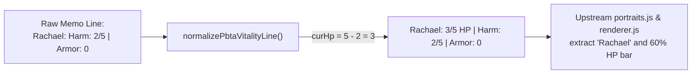

# Contract Sheet: PbtA 2d6 Cartridge & Live Vitality Sync

> **Phase:** 2 — PbtA 2d6 Cartridge Compilation, Tool/Queue RNG, Tandem HP/Harm Vitality & Adventure Companion Bridge  
> **Primary Code:** [pbta-ruleset.js](../../pbta-ruleset.js), [concierge-system-pbta.js](../../concierge-system-pbta.js), [pbta-vitality-sync.js](../../pbta-vitality-sync.js), [pbta-companion-bridge.js](../../pbta-companion-bridge.js), [level-up-runner.js](../../level-up-runner.js)  
> **Related Catalog Entries:** `FEAT-03`, `FEAT-06`, `FEAT-07`, `FEAT-10`, `WRK-03`, `EVT-03`, `EVT-04`, `ADR-MP-01`, `ADR-MP-03`

---

## 1. Subsystem Purpose & Ownership Boundary

Powered by the Apocalypse (PbtA) operates as an ascending **Harm clock** (`0` = uninjured, `maxHarm` = incapacitated/dying), whereas MultiHog's upstream renderer (`renderer.js`) and portrait engine (`portraits.js`) strictly require descending **`Name: cur/max HP`** tokens (`curHp = maxHarm - curHarm`) to compute green-to-red health bar percentages and extract party portrait targets.

**Companion Ownership:**
* **Cartridge & Genre Compilation (`pbta-ruleset.js`, `concierge-system-pbta.js`):** Compiles all PbtA genre presets (`PBTA_GENRES`), custom Ruleset Architect specs (`customGenreSpec`), dynamically scaled Harm tiers (`harmMax` 2–8), custom downing rules (`maxHarmFate`), and initial state memos (`formatInitialPbtaMemo()`).
* **Post-Turn Vitality & Pill Repair (`pbta-vitality-sync.js`):** Runs after every turn via `runSync()` (`index.js`) and inside Living World campaign syncs to synchronize descending `cur/max HP` with ascending `Harm: cur/max`, rescale Harm safely when `harmMax` changes, and heal malformed pill syntax or echoed placeholders.
* **Adventure Companion Bridge (`pbta-companion-bridge.js`):** Intercepts `multihogDnDdoc.md` fetches (`ADR-MP-01`) to inject PbtA documentation matched to the active chat's genre (`detectActiveGenre()`) and custom `customGenreSpec`.
* **XP Progression (`level-up-runner.js`):** Decorates XP bars for Level-Up Concierge proposals (`FEAT-10`) when `xp >= xpMax` (`extractPbtaCharacterState()`).

**Upstream Boundary (Read-Only):**
* Upstream `renderer.js`, `portraits.js`, and `memo-processor.js` are never modified; Companion formats every `[CHARACTER]`, `[PARTY]`, `[COMBAT]`, and `[FACTIONS]` line to satisfy upstream regex anchors out of the box.

---

## 2. Cartridge Slot Map & `customModuleTag` Fingerprints

`buildPbtACartridge(genreKey, overrides)` emits the following snippets and `blockOrder` layout:

| Snippet ID | Tag | `origin` | Purpose |
| :--- | :--- | :--- | :--- |
| `pbta_base_override_role` | `role` | `unlocked_base` | PbtA MC Agenda, Deft Touch outside combat, genre stats/moves, GM Soft/Hard Moves |
| `pbta_base_override_rng` | `rng_system` | `unlocked_base` | `2d6 + Stat` queue rules or `roll_pbta_move` function tool call instructions |
| `pbta_base_override_combat` | `combat` | `unlocked_base` | Dynamic `harmMax` (2–8) Harm tier ladder, Armor subtraction, and `maxHarmFate` |
| `pbta_base_override_ruleset_note` | `ruleset_note` | `custom` | Orderable `<ruleset_note>` reminder before `<constraints>` |
| `pbta_base_override_footer` | `end_of_output_footer` | `unlocked_base` | Compact two-line footer: `Harm`, `XP`, `Hold`, `Location`, `Time` |
| `pbta_base_override_xp` | `xp_system` | `unlocked_base` | `+1 XP` on 6- Miss / milestone trigger & 5 XP advance triggers |
| `pbta_base_override_party` | `[PARTY]_mechanics` | `unlocked_base` | Enabled when `partyMode !== 'solo'`; lean Dungeon World companion format + bench ETA |
| `pbta_base_override_state_memo` | `state_memo` | `unlocked_base` | `TRACKER STATE 0` read-only authority rule |
| `pbta_base_override_constraints` | `constraints` | `unlocked_base` | Non-softballing 6- / 7–9 rules, range tags, Hold/gear exhaustion |
| `pbta_campaign_tone`, `pbta_campaign_factions`, `pbta_custom_world_rules` | `tone` / `factions` / `world_rules` | `custom` | Campaign framing snippets via `buildCampaignContextSnippets()` |

* **Default `blockOrder`:** `['COMBAT', 'CHARACTER', 'PARTY', 'INVENTORY', 'ABILITIES', 'TIME']` (omits `'PARTY'` when `partyMode === 'solo'`, plus appends `customModuleTag` when `worldRules.customModule` is defined).
* **Enabled MultiHog Modules:** `combat`, `character`, `inventory`, `time` (`party` & `'benched party'` enabled iff `partyMode !== 'solo'`; `abilities`, `spells`, `xp` disabled).

---

## 3. Compilation & Override Resolution Contract (`CART-007`)

1. **Genre & Custom Spec Resolution (`resolveEffectivePbtaGenre(genreKey, overrides)`):**
   * Checks `overrides?.customGenreSpec || overrides?.meta?.customGenreSpec || overrides?.dossier?.meta?.customGenreSpec`.
   * Merges `label`, `stats` ($\ge 3$ items), `statDescriptions`, `archetypes`, `moves`, and `maxHarmFate`.
   * `resolveGenreStatsState()` marks `isCustomStats = true` whenever caller `overrides.stats` differs from `PBTA_GENRES.fantasy.stats`, ensuring `buildPbtARngContent()` never emits Fantasy examples (`Cast a Spell [Arcana]`) into custom or non-Fantasy genres.
2. **Downed Fate Resolution (`resolveEffectiveMaxHarmFate(overrides, genre)`):**
   * Resolves explicit `config.maxHarmFate` / `overrides.maxHarmFate`, upgrading default placeholder `'Mortal Peril (Last Breath / Dying)'` to `customGenreSpec.maxHarmFate` when provided by Ruleset Architect (`CART-007`).
   * Applied uniformly in `buildPbtACombatContent()`, `buildPbtACyoaPrompt()`, and `buildPbtAStockPrompts()`.
3. **Harm Scaling & Pacing:**
   * `harmMax` (clamped $\ge 2$, default `5`) scales the severity ladder inside `<combat>`, `stockPrompts.character`, and `end_of_output_footer`.
   * `playstyle`: `'cyoa_5'` emits 5 structured choices, `'cyoa_3'` emits 3, `'freeform'` clears `cyoaConfig.customPromptText` and disables `CYOA_mode`.
4. **Initial Memo Compilation (`formatInitialPbtaMemo(dossier)`):**
   * Resolves `genre = resolveEffectivePbtaGenre(dossier.meta?.systemKey || 'fantasy', { dossier })` so missing or empty `p.stats = {}` and empty `p.startingMoves` fall back to the active/custom genre rather than hardcoded `'Cool +2...'` (`CART-007`).
   * Formats stats safely (`parseInt(val, 10)` prevents `'++2'` on pre-prefixed strings), normalizes moves via `formatMoveAsPill()`, computes initial tandem HP (`Math.max(0, harmMax - harmCurrent)`), emits `[PARTY]` (when not solo), `[DUNGEON]`, `[FACTIONS]`, and seeds any `worldRules.customModule` `[TAG]...[/TAG]` block.

---

## 4. Pre-Turn Generation & Tool Call Contract

Managed in [ruleset-rng-interceptor.js](../../ruleset-rng-interceptor.js) via `mhcGenerationInterceptor()` (`ADR-MP-03`):
* **Prompt / Queue Mode (`diceFunctionTool === false`):**
  * Replaces MultiHog's native polyhedral `[RNG_QUEUE]...[/RNG_QUEUE]` block with `buildPbtA2d6Block(3)` using cryptographic `rollD6()`.
* **Function Tool Mode (`diceFunctionTool === true`):**
  * Strips `[RNG_QUEUE]` completely from the prompt so the LLM does not mix pre-rolled numbers with tool calls.
  * Unregisters native D&D dice tools (`RollTheDice`, `RollTheDiceD100`, etc.) and registers `roll_pbta_move` backed by `executePbtaMoveTool(args)` (`10+ Strong Hit`, `7–9 Weak Hit`, `6- Miss`).
  * `syncActiveRulesetRngMode()` keeps `pbta_base_override_role` and `pbta_base_override_rng` synchronized whenever `diceFunctionTool` toggles, forwarding `stats`, `systemLabel`, `customGenreSpec`, and `dossier`.

---

## 5. Post-Turn State Memo Vitality & Pill Normalization Contract

`syncLivePbtaMemoVitality(s, chatId)` invokes `normalizePbtaMemo()` on both `s.currentMemo` and `s.chatStates[chatId].currentMemo` whenever `Harm`, `Moves:`, or `Conditions:` appear:

| Normalizer | Target Pattern | Normalized Output & Upstream Contract |
| :--- | :--- | :--- |
| **`normalizePbtaVitalityLine()` Pattern 1** | `Name: oldHp/maxHp HP \| Harm: cur/max \| rest` | Recomputes `curHp = Math.max(0, maxHarm - curHarm)` -> `Name: curHp/maxHarm HP \| Harm: cur/maxHarm \| rest` |
| **`normalizePbtaVitalityLine()` Pattern 2** | `Name: Harm: cur/max \| rest` OR `Name: cur/max Harm \| rest` | Injects tandem HP -> `Name: curHp/maxHarm HP \| Harm: cur/maxHarm \| rest` |
| **`normalizePbtaVitalityLine()` Pattern 3** | `Name: cur/max HP \| Armor: N \| Harm: cur/max` | Moves separated Harm adjacent to HP -> `Name: curHp/maxHarm HP \| Harm: cur/maxHarm \| Armor: N` |
| **`normalizePbtaPillsLine()`** | Malformed `Moves:` (nested `()` or trailing prose) or echoed placeholder `Conditions:` | Runs `splitByMoveHeader` + `formatMoveAsPill()` (`Name [+Stat] (desc)`) and `formatConditionAsPill()` (`(-) Detail`) |

---

## 6. Living World & Mid-Campaign Mutation Contract (`CART-004`)

When syncing Blueprint edits into an active game (`mergeDossierIntoLiveMemo(liveMemo, dossier, charName)`):
1. **Harm Rescaling Capacity Proof (`calculateRescaledHarm(curHarm, oldMaxHarm, newMaxHarm)`):**
   * `curHarm === 0` $\implies$ `0`.
   * `curHarm >= oldMaxHarm` (already downed/incapacitated) $\implies$ `newMaxHarm`.
   * `0 < curHarm < oldMaxHarm` (strictly alive) $\implies$ clamped to `aliveCap = Math.max(0, newMaxHarm - 1)`:
     * Compressing scale (`newMax < oldMax`, e.g. `5/6 -> max 4`): `Math.min(aliveCap, Math.max(1, Math.round((cur / oldMax) * newMax)))` -> `3/4 Harm`.
     * Expanding/unchanged scale (`newMax >= oldMax`, e.g. `2/4 -> max 6`): `Math.min(aliveCap, cur)` -> `2/6 Harm`.
2. **Non-Destructive Merge Guarantees (`mergeDossierIntoLiveMemo`):**
   * Preserves `[TIME]`, `[LOCATION]`, active `[COMBAT]`/`[ENEMIES]`, `[PARTY]` companions, active `[CHARACTER]` conditions, Hold, XP, and Status.
   * Updates protagonist playbook, Harm cap (via `rescalePbtaHarmLine()`), normalized `Stats:` (`num > 0 ? '+num' : num`, never `'++2'`), and `((PILLS)) Moves:`.
   * Updates `((PILLS)) Gear:` whenever `dossier.protagonist.gear` supplies explicit custom items (not just when stock placeholder `'Essential adventurer kit'` is present) (`CART-004`).
   * Updates or appends `[FACTIONS]...[/FACTIONS]` when `dossier.factions` is populated, and seeds a newly added `worldRules.customModule` `[TAG]...[/TAG]` block only if that tag is not yet in `liveMemo` (`CART-004`).

---

## 7. Adventure Companion Doc Bridge & Level-Up Progression Contract (`CART-008`)

* **Genre Detection Precedence (`detectActiveGenre()` in `pbta-companion-bridge.js`):**
  1. Explicit override (`customContext.lastGenre` / `customContext.genre` in `PBTA_GENRES` or `'custom'`).
  2. Active chat's `getCompanionActiveCartridge(chatId, s)?.genre` or `getPartitionDossier(s.chatStates[chatId])?.meta?.systemKey` (`CART-008`).
  3. Active memo `Stats:` signature detection (`western`, `scifi`, `anime`, `horror`, `pirate`, `mecha`, `fantasy`).
  4. Global `extension_settings.multihog_companion.lastGenre` fallback.
  5. Default `'fantasy'`.
* **Tailored Documentation (`buildTailoredPbtaDocumentation(genreKey, overrides)`):**
  * Resolves `resolveEffectivePbtaGenre(genreKey, overrides)` so custom Ruleset Architect genres surface their exact stats, moves, and archetypes to MultiHog's Adventure Companion (`ADR-MP-01`, `CART-008`).
* **XP Inspection & Bar Decoration:**
  * `extractPbtaCharacterState(memoText)` parses protagonist name, playbook, tandem HP/Harm, Armor, Stats, Moves, Conditions, and `XP: cur/max`.
  * `forceRenderTrackerView()` invokes `decorateXpBarsForLevelUp()` from `level-up-runner.js` (`FEAT-10`).

---

## 8. Failure Modes, Guardrails & Fallbacks

| Failure Mode | Guardrail / Fallback Behavior |
| :--- | :--- |
| LLM forgets tandem HP (`Name: Harm: 2/5` only) or desyncs HP vs Harm | `normalizePbtaVitalityLine()` recalculates `HP = maxHarm - curHarm` automatically after every turn (`EVT-03`, `EVT-04`). |
| LLM writes nested parens in Moves (`Move (+Stat): When you X (do Y)`) or commas in move prose | `formatMoveAsPill()` moves stat tag to `[+Stat]`, converts inner `(...)` to `[...]`, and wraps the whole description in a single trailing `(...)` (`WRK-03`). |
| LLM echoes stock prompt condition hint (`Starting injury or weakness`) | `normalizePbtaPillsLine()` + `formatConditionAsPill()` strip echoed instructions cleanly. |
| Character reaches Max Harm (`0 HP`) during combat | `<combat>` + `buildPbtACyoaPrompt()` mandate downed crisis / custom `maxHarmFate` choices rather than normal tactical attacks. |

---

## 9. Code Anchors & Test Coverage

* **Primary Implementation:**
  * `pbta-ruleset.js`: `PBTA_GENRES`, `resolveEffectivePbtaGenre`, `resolveEffectiveMaxHarmFate`, `buildPbtACartridge`, `buildPbtARoleContent`, `buildPbtARngContent`, `buildPbtACombatContent`, `buildPbtACyoaPrompt`, `buildPbtAStockPrompts`, `formatMoveAsPill`, `formatConditionAsPill`, `formatInitialPbtaMemo`.
  * `pbta-vitality-sync.js`: `normalizePbtaVitalityLine`, `normalizePbtaPillsLine`, `normalizePbtaMemo`, `syncLivePbtaMemoVitality`, `calculateRescaledHarm`, `rescalePbtaHarmLine`, `mergeDossierIntoLiveMemo`, `extractPbtaCharacterState`, `forceRenderTrackerView`.
  * `pbta-companion-bridge.js`: `detectActiveGenre`, `buildTailoredPbtaDocumentation`, `appendPbtaDocsToManual`, `setupCompanionDocInterceptor`.
  * `concierge-system-pbta.js`: `PbtaSystemAdapter`.
* **Regression Suites:**
  * `tests/pbta-vitality-sync.test.js` & `tests/pbta-vitality-edge-cases.test.js` — Tandem HP/Harm patterns & upstream regex simulation.
  * `tests/pbta-dossier-sync-nondestructive.test.js` — `calculateRescaledHarm`, `mergeDossierIntoLiveMemo`, `CART-004` (`Gear:`/`[FACTIONS]`/`customModule`), `CART-007` (`customGenreSpec` initial memo & `maxHarmFate`).
  * `tests/pbta-companion-bridge.test.js` — `detectActiveGenre` precedence, `ADR-MP-01` fetch bridge, `CART-008` custom genre documentation.
  * `tests/pbta-qol-formatting.test.js` & `tests/pbta-incapacitation-rules.test.js` — Pill hygiene, initial memo formatting, custom downed fates, `harmonize`.
  * `tests/phase12-narrator-prompts.test.js` & `tests/phase13-state-tracker-prompts.test.js` — Tool/queue parity and state tracker extraction prompts.
