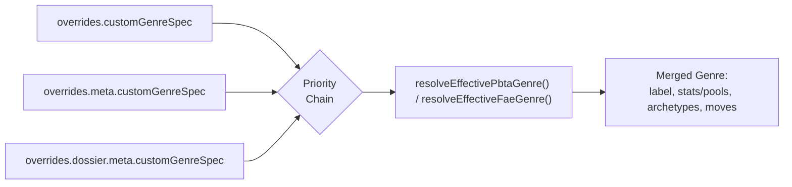

# Contract Sheet: Cartridge Persistence, Compilation & Cross-Chat Isolation

> **Phase:** 1 — Cartridge Lifecycle, Override Resolution, Dual-Layer Storage & Isolation  
> **Primary Code:** [pbta-ruleset-persistence.js](../../pbta-ruleset-persistence.js), [index.js](../../index.js), [pbta-ruleset.js](../../pbta-ruleset.js), [fae-ruleset.js](../../fae-ruleset.js), [history-integrity-guard.js](../../history-integrity-guard.js)  
> **Related Catalog Entries:** `FEAT-03`, `FEAT-04`, `FEAT-05`, `FEAT-12`, `WRK-01`, `WRK-02`, `EVT-01`, `EVT-02`, `EVT-04`

---

## 1. Subsystem Purpose & Ownership Boundary

MultiHog upstream stores active system prompts, `stockPrompts`, `systemPromptTemplate`, `cyoaConfig`, `blockOrder`, and global snippet catalogs inside a single flat settings object (`extensionSettings.rpg_tracker`). Although upstream's `chat-setup.js` snapshots `setup` per chat partition (`rpg_tracker.chatStates[chatId].setup`), its snapshot only saves snippet IDs + boolean enabled states while relying on the global `syspromptSnippetDatabase` for snippet text, and its fallback defaults remain D&D 5e (`WRK-02`).

**Companion Ownership (`pbta-ruleset-persistence.js` + `index.js`):**
1. Compiles self-contained, chat-scoped ruleset cartridges (`pbta`, `fae`, `dnd5e`) containing full override text, genre rules, campaign context (`<tone>`, `<factions>`, `<world_rules>`), and `blockOrder` custom tracker tags.
2. Persists an authoritative per-chat ruleset stamp (`CompanionActiveCartridge`) both inside `extension_settings.multihog_companion.companionActiveCartridges[chatId]` and inside SillyTavern's chat header (`ctx.chatMetadata.CompanionActiveCartridge`).
3. Rehydrates the active chat's exact cartridge and cleanses foreign ruleset artifacts whenever SillyTavern switches chats, reloads (`F5`), or upstream `SETTINGS_UPDATED` / `applyChatSetup()` runs (`runChatChangedCoordinator` -> `ensureActiveChatRulesetConsistency()`).
4. Enforces strict cross-chat projection integrity (`FEAT-12`) so stale memory from Chat A never overwrites Chat B.

**Upstream Boundary (Read-Only):**
* Upstream `chat-setup.js` (`snapshotChatSetup`, `applyChatSetup`) and `chat-persistence.js` (`saveChatState`, `loadChatState`) are never edited; Companion synchronizes them post-hydration via `persistPbtaChatState()`.

---

## 2. Cartridge Slot Map & `customModuleTag` Fingerprints

Every companion-managed snippet ID in `rpg_tracker.customSyspromptLibrary` and `rpg_tracker.syspromptSnippetDatabase` belongs to a strict prefix namespace enforced by `isCompanionRulesetSnippetId(id)` and `isDndFixSnippetId(id)`:

| Namespace / Snippet ID Pattern | Ruleset | `origin` | Purpose & Target Hook |
| :--- | :--- | :--- | :--- |
| `pbta_base_override_*` (`role`, `rng`, `combat`, `footer`, `xp`, `party`, `state_memo`, `constraints`) | `pbta` | `unlocked_base` | Replaces upstream base `<tag>` sections (`syspromptModules[tag] = false`) |
| `pbta_base_override_ruleset_note` | `pbta` | `custom` | Orderable `<ruleset_note>` reminder before `<constraints>` |
| `pbta_campaign_tone`, `pbta_campaign_factions`, `pbta_custom_world_rules` | `pbta` | `custom` | Campaign `<tone>`, `<factions>`, and `<world_rules>` context snippets |
| `fae_base_override_*` (`role`, `rng`, `combat`, `footer`, `xp`, `party`, `state_memo`, `constraints`) | `fae` | `unlocked_base` | Replaces upstream base `<tag>` sections (`syspromptModules[tag] = false`) |
| `fae_base_override_ruleset_note` | `fae` | `custom` | Orderable `<ruleset_note>` 4dF reminder |
| `fae_campaign_tone`, `fae_campaign_factions`, `fae_custom_world_rules` | `fae` | `custom` | Campaign `<tone>`, `<factions>`, and `<world_rules>` context snippets |
| `dnd5e_campaign_tone`, `dnd5e_campaign_factions`, `dnd5e_custom_world_rules` | `dnd5e` | `custom` | D&D 5e Concierge campaign context snippets (with `syspromptModules.world_rules = false` when custom world rules exist) |
| `mhc_dnd_subfooter_override_footer`, `mhc_dnd_deft_touch_pacing` | `dnd5e` | `unlocked_base` / `custom` | Non-PbtA/FAE subfooter alignment (`FEAT-05`) and D&D Deft Touch pacing |

**Custom Tracker Module Fingerprint (`customModuleTag`):**
* Built by `buildCampaignContextSnippets()` in `pbta-ruleset.js` from `worldRules.customModule.tag` (e.g. `ASHLUNG`, `RAD_LOAD`).
* Appended to `cartridge.payload.blockOrder` so upstream renders the custom tracker card without displacing `[COMBAT]`, `[CHARACTER]`, or `[INVENTORY]`.

---

## 3. Compilation & Override Resolution Contract (`CART-001`, `CART-002`)

When compiling or re-hydrating a cartridge (`buildPbtACartridge()`, `buildFaeCartridge()`, `applyPbtACartridge()`, `applyFaeCartridge()`), custom genre definitions generated by Step 3's Ruleset Architect (`customGenreSpec`) MUST survive every call path, including chat switches where only `dossier` or `CompanionActiveCartridge` is present.

* **PbtA Resolution (`resolveEffectivePbtaGenre` in `pbta-ruleset.js`):**
  * Checks `overrides?.customGenreSpec || overrides?.meta?.customGenreSpec || overrides?.dossier?.meta?.customGenreSpec`.
  * Accepts `spec.stats` when length $\ge 3$ (supporting 3-stat to 6-stat PbtA engines) alongside `spec.statDescriptions`, `spec.archetypes`, and `spec.moves`.
  * `PbtaSystemAdapter.normalizeProtagonist()` (`concierge-system-pbta.js`) resolves `resolveEffectivePbtaGenre(genreKey, { dossier })` instead of raw `this.getGenre(genreKey)`.
* **FAE Resolution (`resolveEffectiveFaeGenre` & `normalizeCustomFaePools` in `fae-ruleset.js`):**
  * Checks `overrides?.customGenreSpec || overrides?.meta?.customGenreSpec || overrides?.dossier?.meta?.customGenreSpec`.
  * Normalizes Ruleset Architect `spec.pools` — whether an Array of `{ label, max, zero_debuff, recovery, overflow }` objects or a keyed Dictionary — into canonical `Record<string, FaePool>` entries with stable snake_case keys and palette `barColor` defaults (`green`, `purple`, `amber`, `cyan`).
  * Wired consistently through `buildFaeCartridge()`, `buildFaeStockPrompts()`, `buildFaeCombatContent()`, `buildFaeFooterContent()`, `buildFaeCyoaPrompt()`, `createInitialFaeState()`, and `FaeSystemAdapter.normalizeProtagonist()` (`concierge-system-fae.js`).

---

## 4. Dual-Layer Persistence Contract (`CompanionActiveCartridge` & `chatStates[chatId]`)

1. **`setCompanionActiveCartridge(chatId, cartridgeData, rpgSettings, companionSettings)`:**
   * Writes the record (`cartridgeId`, `genre`, `systemLabel`, `title`, `knobs`, `config`, `customGenreSpec`, `stats`, `pools`, `dossier`, `updatedAt`) to all candidate chat ID forms (`getCandidateChatIds(chatId)` covers whitespace-normalized and `.jsonl`-suffixed keys).
   * Writes the identical record into `ctx.chatMetadata.CompanionActiveCartridge` and awaits `ctx.saveMetadata()` so the ruleset identity lives directly inside line 1 of the chat `.jsonl` file.
   * Synchronizes `dossier` into `rpgSettings.chatStates[cid]` via `setPartitionDossier()` using canonical `companionDossier` + `campaignDossier` alongside ruleset-scoped `pbtaCampaignDossier` / `faeCampaignDossier`.
2. **`applyRulesetCartridge()` (`index.js`):**
   * Ensures `customGenreSpec`, `stats`, and `pools` passed via direct `applyPbtACartridge()` / `applyFaeCartridge()` overrides are stored on `CompanionActiveCartridge` (and folded into `activeDossierSnapshot.meta.customGenreSpec` when a dossier exists).
   * Immediately follows with `persistPbtaChatState(activeChatId)`, `refreshMultihogRuntime()`, and `syncCompanionDiceFunctionTools()`.
3. **`persistPbtaChatState(chatId)`:**
   * Snapshots MultiHog's `chatStates[chatId].setup` via upstream `snapshotChatSetup()`, preserving snippet IDs, enabled states, `syspromptModules`, `stockPrompts`, `systemPromptTemplate`, `cyoaConfig`, `diceFunctionTool`, and `blockOrder`, then calls upstream `saveChatState(chatId)`.

---

## 5. Ruleset Detection Precedence (`isPbtAActive` & `isFaeActive`)

Ruleset detection follows a strict mutual-exclusion hierarchy so `isFaeActive` and `isPbtAActive` can never both return `true` for the same chat:

1. **Priority 0 — Explicit `CompanionActiveCartridge` Stamp:**
   * If `cartridgeId === 'fae'` -> FAE (`true`), PbtA (`false`).
   * If `cartridgeId === 'pbta'` -> PbtA (`true`), FAE (`false`).
   * If `cartridgeId === 'dnd5e'` -> both `false` (strict D&D lock).
2. **Priority 1 — Chat Partition Dossier (`chatStates[cid]`):**
   * `faeCampaignDossier` or `pbtaCampaignDossier.meta.ruleset === 'fae'` claims FAE; `pbtaCampaignDossier` (when not `'fae'` or `'dnd5e'`) claims PbtA.
3. **Priority 2 — Partition Setup Snippets (`chatStates[cid].setup.syspromptSnippetStates`):**
   * Enabled `fae_*` keys claim FAE; enabled `pbta_*` keys claim PbtA.
4. **Priority 3 — Partition Memo Signatures (`chatStates[cid].currentMemo`):**
   * `containsFaeMarkers()` (`FAE Knobs:`, `((BAR...))` secondary pools, or `| Pool:` + `| Scenes:`) claims FAE; `Harm: X/Y` claims PbtA.
5. **Priority 4 — Live Workspace Fallback (Projection Owner Match Only):**
   * Live `customSyspromptLibrary` (`fae_*` / `pbta_*`) or live `rpgSettings.currentMemo` is consulted **only** when `chatId` matches `rpgSettings.chatStateProjectionOwner` (`WRK-01` cross-chat contamination prevention).

---

## 6. Chat-Switch & Reload Hydration Coordinator (`ensureActiveChatRulesetConsistency`)

Triggered deterministically on `CHAT_CHANGED` (`EVT-02`), `APP_READY` (`EVT-01`), and `SETTINGS_UPDATED` (`EVT-04`):

1. **Integrity Short-Circuit:** Checks `checkHistoryPersistenceBlocked()` (`history-integrity-guard.js`); aborts cleanly if history is quarantined.
2. **Resolve Target Dossier & Cartridge:** Scans `getCandidateChatIds(chatId)` partitions for `pbtaCampaignDossier` / `faeCampaignDossier` / `companionDossier`, backfilling from `activeCart.dossier` if a partition was recreated empty.
3. **Branch A — Stock / Concierge D&D (`!isPbta && !isFae`):**
   * If live memory is polluted with `pbta_*` or `fae_*` markers (`isLiveSettingsPollutedWithPbtA` / `isLiveSettingsPollutedWithFae`), executes `cleanseStockDndSettings()` (purges foreign snippets, restores `factory.syspromptModules`, `factory.stockPrompts`, `factory.systemPromptTemplate`, `factory.cyoaConfig`, `factory.blockOrder`, stamps `cartridgeId: 'dnd5e'`).
   * Synchronizes per-chat `dnd5e_campaign_*` / `dnd5e_custom_*` context snippets if `dndDossier` has `tone`, `factions`, or `worldRules` (or removes stale D&D context snippets when switching back to a plain D&D chat).
4. **Branch B — Active FAE or PbtA Chat:**
   * Strips foreign ruleset snippets (`stripForeignRulesetSnippets()` removes opposite-ruleset snippets and `isDndFixSnippetId` entries, plus prunes stale `lib:*` keys from `syspromptSectionOrder`).
   * Compiles `targetCartridge` via `buildFaeCartridge(genreKey, overrides)` or `buildPbtACartridge(genreKey, overrides)` — carrying `customGenreSpec`, `stats`/`pools`, `systemLabel`, `heroicTier`, and resolved `diceFunctionTool` (`resolveToolModeForChat()`).
   * Compares live state against `targetCartridge` with **`doesLiveLibraryMatchCartridge(s, targetCartridge, prefix)` (`CART-003`):**
     * Checks snippet count, `enabled`, `origin`, and exact `content` match.
     * Checks `stockPrompts.character`, `stockPrompts.combat`, `stockPrompts.party`.
     * Checks `systemPromptTemplate`, `cyoaConfig.useCustomPrompt`, `cyoaConfig.customPromptText`, `diceFunctionTool`, and `blockOrder` completeness (including any `customModuleTag`).
   * On any mismatch or missing live overrides, executes `applyStandaloneCartridgeHydration()` (or `applyCartridgeFn` when injected), updating `customSyspromptLibrary`, `syspromptSnippetDatabase`, `syspromptModules`, `stockPrompts`, `systemPromptTemplate`, `cyoaConfig`, `blockOrder`, `modules`, `diceFunctionTool`, and snapshotting `chatStates[resolvedChatId]`.

---

## 7. Cross-Chat Isolation & Projection Integrity Guards

* **Same-Ruleset Bleeding Prevention (`cartridge-compiler-and-isolation.test.js`):** Upstream `applyChatSetup()` restores snippet enabled states from `setup.syspromptSnippetStates`, reading text from the shared global `syspromptSnippetDatabase`. Whenever Chat A (e.g. *Cosmic Horror* + `worldRules`) switches after Chat B (*OSR Dungeon*), `doesLiveLibraryMatchCartridge()` catches the stale snippet text and `applyStandaloneCartridgeHydration()` overwrites the global library with Chat A's exact cartridge before generation.
* **Unstarted Chat Protection (`unstarted-chat-sync-guard.test.js`):** `ensureActiveChatRulesetConsistency()` refuses to force PbtA or FAE onto an unstarted chat (`!activeCart && !dossier && !isAdventureActive(chatId)`), cleansing stale settings to stock D&D instead.
* **Projection Ownership Guard (`FEAT-12`, `history-integrity-guard.js`):** `checkTrackerProjectionIntegrity()` verifies `chatStateProjectionOwner` vs active `chatId` before `hydratePbtaMemoIfNeeded()` renders or persists memos.

---

## 8. Failure Modes, Guardrails & Fallbacks

| Failure Mode | Guardrail / Fallback Behavior |
| :--- | :--- |
| Upstream MultiHog `defaults.js` or `constants.js` dynamic import fails during `cleanseStockDndSettings()` | Falls back to explicit `dndBaseModules` map and strips FAE/PbtA `systemPromptTemplate` patterns via regex before deleting stale keys. |
| Browser reload (`F5`) clears `extension_settings` cache before `saveMetadata` synced | `getCompanionActiveCartridge()` checks `ctx.chatMetadata.CompanionActiveCartridge` on line 1 of the `.jsonl` chat file as secondary ground truth. |
| Upstream `SETTINGS_UPDATED` fires recursively while Companion repairs `rpg_tracker` | `SETTINGS_UPDATED` listener (`EVT-04`) is shielded by `_isSettingsSyncActive` in `index.js`. |
| Custom `customGenreSpec` arrays or partial objects arrive from Ruleset Architect | `normalizeCustomFaePools()` converts both Array and Dictionary schemas cleanly and defaults missing `barColor` / `zero_debuff` / `on_overflow` fields. |

---

## 9. Code Anchors & Test Coverage

* **Primary Implementation:**
  * `pbta-ruleset-persistence.js`: `getCandidateChatIds`, `getCompanionActiveCartridge`, `setCompanionActiveCartridge`, `isPbtAActive`, `isFaeActive`, `doesLiveLibraryMatchCartridge`, `cleanseStockDndSettings`, `ensureActiveChatRulesetConsistency`.
  * `index.js`: `applyRulesetCartridge`, `applyPbtACartridge`, `applyFaeCartridge`, `restoreStockDnd`, `hydratePbtaMemoIfNeeded`.
  * `pbta-ruleset.js`: `resolveEffectivePbtaGenre`, `buildPbtACartridge`, `buildCampaignContextSnippets`.
  * `fae-ruleset.js`: `normalizeCustomFaePools`, `resolveEffectiveFaeGenre`, `buildFaeCartridge`.
* **Regression Suites:**
  * `tests/cartridge-compiler-and-isolation.test.js` — Upstream `sysprompt.txt` compiler simulation, same-ruleset bleed prevention, D&D context isolation, `customGenreSpec` preservation (`CART-001` – `CART-003`).
  * `tests/pbta-ruleset-persistence.test.js` — Multi-layer detection, Chat Setup link survival, F5 reload simulation.
  * `tests/fae-persistence.test.js` — FAE/PbtA/D&D mutual exclusion & badge rendering.
  * `tests/unstarted-chat-sync-guard.test.js` & `tests/stock-dnd-sanitization.test.js` — Unstarted chat hygiene & D&D cleansing.
  * `tests/history-integrity-guard.test.js` — Projection integrity & quarantine checks.
