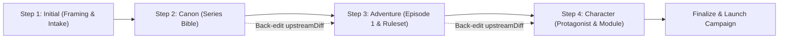
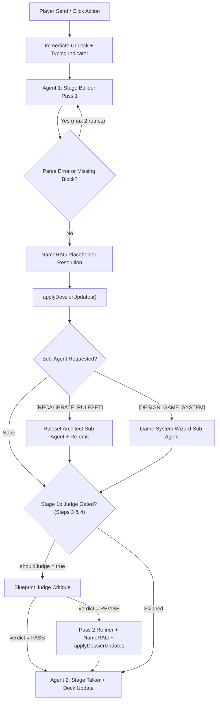

# Session Zero Concierge — Architecture & Audit Hub

This folder holds the **stage-by-stage contract sheets, cross-cutting syntax specs, and audit bug logs** for MultiHog Companion's **Session Zero Concierge** subsystem (~22k lines across 27 modules).

Instead of high-level prose, each document traces **exact contracts across boundaries** (Prompt ↔ Lexer ↔ Parser ↔ NameRAG ↔ State Store ↔ UI/Buttons ↔ Launch Runner) so seam drift and missing safeguards become immediately visible.

---

## 1. Navigation Modes & Input Modes

The Concierge UI ([concierge-ui.js](file:///var/home/dlittle/ai-stack/sillytavern-test/extensions/MultiHogCompanion/concierge-ui.js)) operates in two top-level navigation modes (`currentNavMode`):

1. **`new-adventure` (4-Stage Session Zero Pipeline):**
   * **`initial`** — **Step 1 (`🧭 Initial`)**: Intake (attachments, ST character cards, lorebooks), framing Q&A (`[FRAMING]`), Vibe vs. Archivist mode sizing.
   * **`canon`** — **Step 2 (`📚 Canon`)**: Series Bible ingestion/dedup/bridge/expansion, `[CANON_ENTRY]`, enable/disable/remove mutations, `[WORLD_RULES]`, optional `[DESIGN_GAME_SYSTEM]`.
   * **`adventure`** — **Step 3 (`🗺️ Adventure`)**: Ruleset Picker, Ruleset Architect sub-agent, ruleset switching (`agnosticBones`), Episode 1 `[KICK]`, `[MAP]`, `[MONSTER]`, `[NPC]`, `[FACTION]`, `[CYOA]`, `[CONFIG]`, Stage 1b Judge & Pass 2 Refiner.
   * **`character`** — **Step 4 (`👤 Character`)**: Protagonist sheet (`[PROTAGONIST]`), Game System Wizard delegation (`[DESIGN_GAME_SYSTEM]`), cross-stage harmonization, Launch readiness.
2. **`living-world` (Post-Launch Campaign Editor):**
   * Loads an active launched campaign chat and edits live dossier / lorebook partitions (`syncPbtaCampaignUpdates`).

Input sizing (`concierge-canon.js`):
* **Vibe Mode**: Small lore/attachments (~6k tokens or less) scaffold immediately via Builder prompts.
* **Archivist Mode**: Large lorebooks/documents trigger attach-time chunking, labeling, dedup, a first-turn briefing (`[CANON_INVENTORY]` + `[SUGGESTED_STARTS]`), retrieval (`[CANON_FOCUS]`), and `[PROMOTE_CANON]` promotion.

---

## 2. Pipeline & Per-Turn Execution Flow

### Stage Progression & Handoff

### Single Interactive Builder Turn (`handleUserSend`)

---

## 3. Concierge Module Inventory (27 Modules)

| Layer | Modules |
| :--- | :--- |
| **Orchestration, UI & State** | `concierge-ui.js`, `concierge-state-store.js`, `concierge-intake-ui.js`, `concierge-deck-renderer.js`, `concierge-debug-inspector.js` |
| **Transport & Prompts** | `concierge-connection.js`, `concierge-prompt.js` |
| **Delegated Sub-Agents** | `concierge-ruleset-architect.js`, `game-system-bridge.js` |
| **Parsing & Serialization** | `concierge-block-lexer.js`, `concierge-parser.js`, `concierge-markdown-codec.js` |
| **Canon & Intake Readers** | `concierge-canon.js`, `concierge-files.js`, `concierge-card-reader.js`, `concierge-lore-reader.js` |
| **Ruleset System Adapters** | `concierge-system-base.js`, `concierge-system-registry.js`, `concierge-system-pbta.js`, `concierge-system-fae.js`, `concierge-system-dnd5e.js` |
| **Name Diversity Engine** | `namerag-client.js`, `namerag-hooks.js` |
| **Launch & Distribution** | `concierge-runner.js`, `concierge-lore-distributor.js`, `concierge-npc-format.js`, `concierge-pc-format.js` |

*(UI template: `concierge-modal.html`.)*

---

## 4. Standard Stage Contract Template (9 Sections)

Every stage and cross-cutting audit doc in `docs/concierge/` follows this 9-section checklist so gaps and regressions cannot hide:

1. **Entry & Exit Conditions** — Auto-pass vs. manual triggers, snapshot diffs, unlock gates, back-navigation harmonization.
2. **Code Surface** — Exact source files, entry functions, and line ranges.
3. **LLM Pass Flow** — Exact sequence of LLM/sub-agent calls, retries, and Stage 1b Judge gating.
4. **Prompt ↔ Parser ↔ UI Matrix** — Every directive mapped across `Prompted? | Parsed? | Mutates State? | Rendered in Deck? | Gaps`.
5. **Context In & Handoff Out** — `formatStageContinuityBrief`, `formatDossierForContext`, `stageNotes`, `upstreamDiff`, and downstream contracts.
6. **Invariants & Guardrails** — Sentinel filters, resolved-name preservation, Talker truth-grounding, fallback safety.
7. **Audit Findings Log** — Discovered issues, status, fix commits/descriptions, and regression test pointers.
8. **UI Controls, Button Gating & Immediate Pre-Inference Feedback** — Matrix covering every button and stepper in `concierge-modal.html` / `concierge-ui.js`:
   `Control | Enabled When | Disabled/Locked During Inference? | Pre-Inference Visual Feedback? | Gaps`
   *(Verifies out-of-order steps cannot be pressed accidentally and every press shows immediate feedback before awaiting inference.)*
9. **Multi-Turn Refinement (`N`-Turn) Invariants** — Verifies each stage supports **0, 1, 2, or N** consecutive user refinement turns cleanly without one-shot flag lockouts, duplicate entities, stripped badges, or broken downstream harmonization.

---

## 5. Phased Audit Roadmap & Phase 0 Findings

### Planned & Active Documents
* **Phase 1 (Complete):** [cross-cutting-syntax.md](file:///var/home/dlittle/ai-stack/sillytavern-test/extensions/MultiHogCompanion/docs/concierge/cross-cutting-syntax.md) — Master Prompt ↔ Lexer ↔ Parser ↔ NameRAG ↔ Codec ↔ Busy-Lock ↔ Debug spine matrix (`CONC-005`–`CONC-009`).
* **Phase 2:** `stage-1-initial.md` & `stage-2-canon.md` — Intake, Framing, Vibe/Archivist modes, Canon ingestion/dedup/synthesis, and Stage 1 → 2 → 3 handoffs.
* **Phase 3:** `stage-3-adventure.md` & `stage-4-character.md` — Ruleset Picker, Ruleset Architect, Ruleset switching, Critic/Refiner, Game System Wizard, System Adapters, Blueprint Deck, Button Gating & N-turn refinements.
* **Phase 4:** `launch-and-living-world.md` — Finalize & Launch, `_Bestiary` & partition distribution, Map Architect seeding, and `living-world` campaign editing.

### Phase 0 & Phase 1 Resolved Bugs
| ID | Issue Found | Root Cause & Fix | Regression Tests |
| :--- | :--- | :--- | :--- |
| `CONC-001` | Step 3 failed to remove queued adversaries cleanly (emitted dummy `[MONSTER] status: Cleared` instead) | `buildStage3AdventureBuilderPrompt()` (`concierge-prompt.js`) omitted `[CLEAR_MONSTERS]` / `[REMOVE_*]` syntax; now documented explicitly along with `[UPDATE_DOSSIER]` framing. | `tests/concierge-stage-scoped.test.js` |
| `CONC-002` | `[RECALIBRATE_RULESET: none]` triggered spurious Ruleset Architect sub-agent runs; `[CONFIG]` pipe templates (`true \| false`) mutated dials | `applyDossierUpdates()` (`concierge-parser.js`) now filters sentinel no-ops (`none`, `n/a`, `null`, etc.) on `[RECALIBRATE_RULESET]` / `[DESIGN_GAME_SYSTEM]` and ignores pipe-delimited single-value `[CONFIG]` templates. | `tests/concierge-stage-scoped.test.js` |
| `CONC-003` | Stray `summary: ... [/UPDATE_DOSSIER]` before a second `[UPDATE_DOSSIER]` block or multiple blocks dropped mutations | `applyDossierUpdates()` (`concierge-parser.js`) now extracts and merges all closed `[UPDATE_DOSSIER]...[/UPDATE_DOSSIER]` blocks cleanly. | `tests/concierge-stage-scoped.test.js` |
| `CONC-004` | Debug Inspector displayed `Attempt 3/2` when follow-up passes ran | `renderDebugInspectorDom()` (`concierge-debug-inspector.js`) now distinguishes numeric Pass 1 attempts from follow-up passes (`Pass 1 (1/2) + ruleset-recalibration + 1b (Refiner)`). | `tests/concierge-debug-inspector.test.js` |
| `CONC-005` | Lexer lookahead/stripper/closer-repair missed `[UPSERT_CANON_ENTRY]`, `[GAME_SYSTEM]`, `[REMOVE_*]`, `[CLEAR_*]`, sub-agent tags, and bare `/update_dossier` / `/noop` | Updated `NEXT_DOSSIER_BLOCK_LOOKAHEAD`, `stripConciergeStateBlocks()`, and `normalizeMalformedDossierClosers()` in `concierge-block-lexer.js`. | `tests/concierge-stage-scoped.test.js` |
| `CONC-006` | `ConciergeStateStore.applyDraftToSessionZero()` restored unhealed `draft.dossier`, preserving corrupted/duplicate NPCs across reloads | Wired `healAndNormalizeDossier(draft.dossier)` into `applyDraftToSessionZero()` (`concierge-state-store.js`). | `tests/concierge-stage-scoped.test.js` |
| `CONC-007` | Stepper, ruleset cards, and action buttons remained clickable or un-dimmed during `runStageAutoPass`, `buildCanonFromFraming`, and ruleset switches | Added centralized `setConciergeBusyState()` + `isGenerating` guards across `setAdventureStep()`, ruleset clicks, and all inference flows (`concierge-ui.js`). | Verified in code & full test suite |
| `CONC-008` | `buildTalkerInstructionNotice()` lacked verified parser mutation list, allowing Talker to echo unapplied summary claims | Added 5th parameter `appliedChanges` emitting `[APPLIED_BLUEPRINT_CHANGES: ...]` in `concierge-markdown-codec.js`, wired from `concierge-ui.js`. | `tests/concierge-debug-inspector.test.js` |
| `CONC-009` | `shouldRunContemplativeJudgePass()` missed FAE encounter change strings (`Added FAE Encounter "..."`) | Expanded `monsters` category check to `/Adversary\|FAE Encounter\|monsters/i` in `concierge-markdown-codec.js`. | `tests/concierge-stage-scoped.test.js` |
