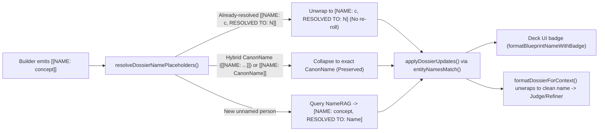

# Cross-Cutting Syntax & Concierge Spine Contract

This contract sheet traces the **shared spine** connecting every Session Zero stage (`initial`, `canon`, `adventure`, `character`) and `living-world` mode across:
[concierge-prompt.js](file:///var/home/dlittle/ai-stack/sillytavern-test/extensions/MultiHogCompanion/concierge-prompt.js) ↔
[concierge-block-lexer.js](file:///var/home/dlittle/ai-stack/sillytavern-test/extensions/MultiHogCompanion/concierge-block-lexer.js) ↔
[concierge-parser.js](file:///var/home/dlittle/ai-stack/sillytavern-test/extensions/MultiHogCompanion/concierge-parser.js) ↔
[namerag-hooks.js](file:///var/home/dlittle/ai-stack/sillytavern-test/extensions/MultiHogCompanion/namerag-hooks.js) ↔
[concierge-state-store.js](file:///var/home/dlittle/ai-stack/sillytavern-test/extensions/MultiHogCompanion/concierge-state-store.js) ↔
[concierge-markdown-codec.js](file:///var/home/dlittle/ai-stack/sillytavern-test/extensions/MultiHogCompanion/concierge-markdown-codec.js) ↔
[concierge-connection.js](file:///var/home/dlittle/ai-stack/sillytavern-test/extensions/MultiHogCompanion/concierge-connection.js) ↔
[concierge-ui.js](file:///var/home/dlittle/ai-stack/sillytavern-test/extensions/MultiHogCompanion/concierge-ui.js) ↔
[concierge-debug-inspector.js](file:///var/home/dlittle/ai-stack/sillytavern-test/extensions/MultiHogCompanion/concierge-debug-inspector.js).

---

## 1. Master Directive Matrix (Prompt ↔ Lexer ↔ Parser ↔ Deck)

All section blocks inside `[UPDATE_DOSSIER] ... [/UPDATE_DOSSIER]` (or standalone direct blocks via `hasDirectBlocks`) are extracted via `matchDossierSectionBlocks()` and `NEXT_DOSSIER_BLOCK_LOOKAHEAD` in `concierge-block-lexer.js`. Bare unbracketed closing tags (`/protagonist`, `/npc`, `/update_dossier`, `/noop`, etc.) are repaired by `normalizeMalformedDossierClosers()`.

| Directive / Tag | Stage(s) Prompted | Lexer (`concierge-block-lexer.js`) | Parser (`concierge-parser.js`) | Mutates | Deck / UI Surface | Notes & Guards |
| :--- | :--- | :--- | :--- | :--- | :--- | :--- |
| `[UPDATE_DOSSIER] ... [/UPDATE_DOSSIER]` | Steps 1–4, Refiner, Living World | Lookahead + `stripConciergeStateBlocks` + bare `/update_dossier` closer repair | Merges all closed `[UPDATE_DOSSIER]` blocks; falls back to unclosed / `hasDirectBlocks` | Wrapper | Ignored in chat bubbles | Multiple closed blocks merge safely (ignoring stray leading closer). |
| `[NOOP]` | Steps 1–4 | `stripConciergeStateBlocks` + bare `/noop` closer repair | Early return `isNoop: true` | None | Ignored in chat bubbles | Skips Pass 2 Judge/Refiner; sends `[BUILDER_REPORT]` to Talker. |
| `[CONTEMPLATION]` | Monolithic Builder | Lookahead + `stripConciergeStateBlocks` + bare closer | Parsed into `contemplation` | `dossier.contemplation` | Debug Inspector scratchpad | Stripped from Talker display; never re-emitted in Pass 2 Refiner. |
| `[FRAMING]` | Step 1 (`initial`) | Lookahead + `stripConciergeStateBlocks` | Updates `meta.title`, `premise`, `focalLens`, `tone`, `framingComplete` | `dossier.meta` | Overview card & Step 2 unlock | Refreshes NameRAG candidate seeds when changed. |
| `[CANON_ENTRY]` / `[UPSERT_CANON_ENTRY]` / `[CANON_UPDATE]` | Step 2 (`canon`) | Lookahead + `stripConciergeStateBlocks` + bare closer | Pushes `canonMutations` (`action: 'upsert'`) | `stagedCanonEntries` (in UI store) | Series Bible Deck | UI applies via `applyCanonMutationsToStore()` and updates `stageNotes.canon`. |
| `[DISABLE_CANON]` / `[ENABLE_CANON]` / `[REMOVE_CANON]` | Step 2 (`canon`) | Lookahead + `stripConciergeStateBlocks` + bare closer | Pushes `canonMutations` (`disable` / `enable` / `remove`) | `stagedCanonEntries` | Series Bible toggle/card | Cleaned with `cleanTargetName()`. |
| `[CONFIG]` | Step 3 (`adventure`), Living World | Lookahead + `stripConciergeStateBlocks` | Updates `config` dials & FAE `knobs` | `dossier.config` | Campaign Dials card | Ignores pipe-delimited template strings (`true \| false`, etc.) on single-value dials; `max_harm_fate` allows `rule \| token`. |
| `[KICK]` | Step 3 (`adventure`) | Lookahead + `stripConciergeStateBlocks` | Updates `theKick.startingLocation`, `crisis`, `openingPrompt` | `dossier.theKick` | Episode 1 Kick card | Step 3 Judge audits immediate FAE/PbtA tension. |
| `[MAP]` | Step 3 (`adventure`) | Lookahead + `stripConciergeStateBlocks` | Upserts `maps` (by `site`) | `dossier.maps` | Queued Maps card | Title lines blocked from personal NameRAG names. |
| `[MONSTER]` | Step 3 (`adventure`) | Lookahead + `stripConciergeStateBlocks` | Upserts `monsters` via `entityNamesMatch` | `dossier.monsters` | Queued Adversaries card | Routes to `{prefix}_Bestiary` + Map Architect at launch (never NPCs drawer). |
| `[NPC]` | Steps 3–4, Refiner | Lookahead + `stripConciergeStateBlocks` | Upserts `npcs` via `entityNamesMatch` | `dossier.npcs` | Allies & Supporting NPCs | Preserves healthy `[NAME: ..., RESOLVED TO: ...]` badge when patched by clean name. |
| `[FACTION]` | Steps 2–3 | Lookahead + `stripConciergeStateBlocks` | Upserts `factions` via `entityNamesMatch` | `dossier.factions` | Active Factions card | Title protected by Non-Person Entity Guard in `namerag-hooks.js`. |
| `[CYOA]` | Step 3 (`adventure`) | Lookahead + `stripConciergeStateBlocks` | Updates `cyoaExamples` | Blueprint Deck / Step 3 | Used as opening choice seeds. |
| `[PROTAGONIST]` | Step 4 (`character`) ONLY | Lookahead + `stripConciergeStateBlocks` | Updates `protagonist` & adapter stats/pools | `dossier.protagonist` | Protagonist Card | Explicitly forbidden in Steps 2 & 3 (including Stage 1b Critic & Refiner). |
| `[WORLD_RULES]` | Step 2 (`canon`), Living World | Lookahead + `stripConciergeStateBlocks` | Upserts `worldRules.axioms` | `dossier.worldRules.axioms` | World Axioms & Laws card | Mapped into `{prefix}_Rules` at launch. |
| `[CUSTOM_MODULE]` / `[GAME_SYSTEM]` | Step 4, Game System Wizard | Lookahead + `stripConciergeStateBlocks` + bare closer | Normalized into `worldRules.customModule` | `dossier.worldRules.customModule` | Custom Tracker card | `[GAME_SYSTEM]` acts as full alias to `[CUSTOM_MODULE]`. |
| `[RECALIBRATE_RULESET: ...]` | Step 3 (`adventure`) | Lookahead + `stripConciergeStateBlocks` | Populates `report.recalibrateRuleset` | Invokes Ruleset Architect + Step 3 pass | Genre / Stats / Archetypes | Filters no-op sentinels (`none`, `n/a`, `null`, `false`, `no`, `unchanged`). |
| `[DESIGN_GAME_SYSTEM: ...]` | Steps 2 & 4 | Lookahead + `stripConciergeStateBlocks` | Populates `report.designGameSystem` | Invokes Game System Wizard -> `customModule` | Custom Tracker card | Filters no-op sentinels (`none`, `n/a`, `null`, etc.). |
| `[REMOVE_NPC/MONSTER/MAP/FACTION/WORLD_RULE: ...]` | Step 3, Refiner | Lookahead + `stripConciergeStateBlocks` | Deletes matching entry (`entityNamesMatch` for NPC/Monster/Faction) | Removes from array | Card removed in Deck | Documented explicitly in Step 3 (`CONC-001`) and Refiner. |
| `[REMOVE_CUSTOM_MODULE]` / `[REMOVE_GAME_SYSTEM]` | Refiner, Step 4 | Lookahead + `stripConciergeStateBlocks` | Clears `worldRules.customModule = null` | Removes Custom Tracker card | `concierge-block-lexer.js` updated (`CONC-005`). |
| `[CLEAR_NPCS/MONSTERS/MAPS/FACTIONS/WORLD_RULES]` | Step 3, Refiner | Lookahead + `stripConciergeStateBlocks` | Empties target array cleanly | Empties card list | Documented in Step 3 (`CONC-001`). |
| `[PROMOTE_CANON: ...]` | Archivist Talker / Step 2 | Stripped via `stripConciergeStateBlocks` | Handled by Archivist canon store | Promotes background entry to active | Checked against `stagedCanonEntries`. |

---

## 2. Resolved-Name Lifecycle (NameRAG Preservation)

Key invariants enforced in `namerag-hooks.js` and `concierge-parser.js`:
1. **Canon Preservation:** Non-disabled `canonEntries` and `activeDossier.npcs` register in `usedNames` and `canonLookup`. Hybrids like `Lynette ([[NAME: ...]])` or `[[NAME: npc]] (Marcus)` collapse to plain Canon names, while `[NAME: wasteland medic] (Vault 13)` keeps resolving via NameRAG because `Vault 13` is a `LOCATION`.
2. **No Double-Rolling Resolved Tokens (`CONC-004`/`namerag-hooks.js`):** Double-bracketed echoes (`[[NAME: concept, RESOLVED TO: Zaelyn]]`) are intercepted before NameRAG lookup and unwrapped cleanly (`source: 'Already Resolved (Unwrapped)'`), while `parseResolvedNameToken()` safely splits multi-`RESOLVED TO:` chains.
3. **Clean Context & Clean-Name Patching:** `formatDossierForContext()` strips `[NAME: ..., RESOLVED TO: ...]` down to clean names (`name: Zaelyn`) before handing `[CURRENT_LIVE_BLUEPRINT]` to the Judge/Refiner. When Pass 2 or user follow-ups emit clean `name: Zaelyn`, `entityNamesMatch()` patches in-place without dropping the stored badge token or duplicating entities—while still keeping two distinct concept tags with colliding fallback names separate.

---

## 3. Talker Truth-Grounding & Stage 1b Judge Gating

1. **Judge Trigger (`shouldRunContemplativeJudgePass` in `concierge-markdown-codec.js`):**
   * Bypassed in lightweight stages (`initial`, `canon`) and on `NOOP` / `SYNTAX_ERROR` turns.
   * Fires in `adventure` / `character` when attachments were processed, blueprint transitioned from blank (`wasBlank && hasCoreNow`), or `categories.size >= 3` across `meta`, `protagonist`, `npcs`, `monsters` (matching `Adversary|FAE Encounter|monsters`), `maps`, `factions`, `kick`, `cyoa`, `worldRules`, `customModule`, `config`.
2. **Stage Scoping on Judge/Refiner:**
   * When `currentNavMode === 'new-adventure'` and `currentAdventureStep === 'adventure'`, `{ stage: 'adventure' }` tells `buildConciergeCriticContext()` and `buildConciergeRefinerContext()` not to critique or emit `[PROTAGONIST]`.
3. **Talker Instruction Grounding (`buildTalkerInstructionNotice`):**
   * `MUTATED` / `NOOP` receive `[BUILDER_REPORT: 
]`.
   * On `MUTATED`, `handleUserSend()`, `runStageAutoPass()`, and `runStageHarmonizationPass()` pass actual applied parser mutations via `[APPLIED_BLUEPRINT_CHANGES: ...]` (`CONC-008`) so the Talker cannot hallucinate removals/additions that the Builder failed to emit cleanly.
   * `SYNTAX_ERROR` receives `[BUILDER_ERROR: ...]`; `UNRECOGNIZED_OUTPUT` receives `[BUILDER_NOTICE: ... Do NOT claim an edit was made ...]`.

---

## 4. Global Modal Busy-Lock & Button Gating Matrix (`CONC-007`)

All async LLM inference paths in `concierge-ui.js` flow through `setConciergeBusyState(busy)` synchronously **before** any `await`, and restore controls inside `finally`:

| Control (`concierge-modal.html` / `concierge-ui.js`) | Enabled When Idle | Locked During Inference (`busy = true`) | Immediate Pre-Inference Feedback | Restored On Settle (`finally`) |
| :--- | :--- | :--- | :--- | :--- |
| `#mhc_send_btn` | `!isGenerating && (hasText \|\| pendingAttachments.length > 0)` | Disabled via `updateSendButtonState()` | Send disabled immediately; `#mhc_stop_btn` shown; typing bubble appended | `updateSendButtonState()` |
| `#mhc_new_adventure_stepper .mhc-step-btn` | Visible when `unlockedSteps[step]` is true | Disabled + `aria-busy="true"` + `opacity: 0.55` + `isGenerating` early-return in `setAdventureStep()` | Dimmed/unclickable immediately; stage auto-pass shows typing indicator | Re-enabled; active state via `updateStepperUi()` |
| `.mhc-ruleset-card`, `.mhc-ruleset-btn`, `#mhc_header_system_badge` | Idle | Disabled + `aria-busy="true"` + `isGenerating` early-return | Ruleset Architect typing bubble appended immediately before `await` | Re-enabled via `setConciergeBusyState(false)` |
| `#mhc_deck_tune_ruleset_btn` | Idle & `activeDossier.meta.rulesetConfirmed` | Disabled + `aria-busy="true"` | Recalibration typing bubble appended immediately after prompt confirm | Re-enabled via `setConciergeBusyState(false)` |
| `#mhc_reset_session_btn` | Idle | Disabled + `aria-busy="true"` | Dimmed while busy so session cannot wipe mid-flight | Re-enabled via `setConciergeBusyState(false)` |
| `#mhc_launch_campaign_btn` | `!isGenerating && (currentNavMode !== 'new-adventure' \|\| currentAdventureStep === 'character' \|\| unlockedSteps.character)` | Always disabled + `aria-busy="true"` + `opacity: 0.5` | Cannot launch partial/mid-inference state | Recomputed strictly via `evaluateStepUnlocks()` (`isReady`) |

---

## 5. Transport, Draft Persistence & Debug Trace Contract

* **Transport (`concierge-connection.js`):** `stripThinkingContent()` strips `<think>`, `<thought>`, `<thinking>`, `<reasoning>`, markdown thought fences, and leading CoT preambles while optionally preserving `<choices>/<button>` (`preserveChoices: true`). `extractTextFromApiResponse()` inspects both `content` and `reasoning_content`/`reasoning` and rejects starved reasoning dumps instead of feeding prose into the parser.
* **Draft Restore Healing (`concierge-state-store.js`):** `applyDraftToSessionZero()` runs `healAndNormalizeDossier(draft.dossier)` on restore (`CONC-006`) so saved `localStorage` drafts automatically normalize pools/knobs and heal/deduplicate any previously corrupted NPC tokens.
* **Debug Trace (`concierge-debug-inspector.js`):** Renders Pass 1 numeric retries separately from follow-up passes (`Pass 1 (1/2) + ruleset-recalibration + 1b (Refiner)`), Contemplation scratchpads, Judge verdicts, NameRAG pools, and `activeDossier` snapshots.

---

## 6. Phase 1 Audit Findings Log

| ID | Bug / Gap Found | Fix Applied | Regression Test |
| :--- | :--- | :--- | :--- |
| `CONC-005` | Lexer lookahead/stripper/closer-repair missed `[UPSERT_CANON_ENTRY]`, `[GAME_SYSTEM]`, `[REMOVE_GAME_SYSTEM]`, `[RECALIBRATE_RULESET]`, `[DESIGN_GAME_SYSTEM]`, `[REMOVE_*]`, `[CLEAR_*]`, and bare `/update_dossier` / `/noop` | Updated `NEXT_DOSSIER_BLOCK_LOOKAHEAD`, `stripConciergeStateBlocks()`, and `normalizeMalformedDossierClosers()` in `concierge-block-lexer.js` | `tests/concierge-stage-scoped.test.js` |
| `CONC-006` | `ConciergeStateStore.applyDraftToSessionZero()` stored raw unhealed `draft.dossier` from `localStorage`, preserving duplicate/corrupted entities on page reload | Wired `healAndNormalizeDossier(draft.dossier)` into `applyDraftToSessionZero()` in `concierge-state-store.js` | `tests/concierge-stage-scoped.test.js` |
| `CONC-007` | Async paths (`runStageAutoPass`, `runStageHarmonizationPass`, Step 2 `buildCanonFromFraming`, Step 3 ruleset cards, stepper buttons, Launch button) did not globally lock buttons before awaiting inference | Added centralized `setConciergeBusyState()` and guarded `setAdventureStep()`, `.mhc-ruleset-card/.mhc-ruleset-btn`, `#mhc_header_system_badge`, and all async flows in `concierge-ui.js` | Code-verified across `concierge-ui.js`; verified via full suite |
| `CONC-008` | `buildTalkerInstructionNotice()` only passed free-text `builderSummary` to Talker, allowing Talker to parrot LLM intentions (e.g. `"removed adversaries"`) even when no entities changed | Added 5th param `appliedChanges` emitting `[APPLIED_BLUEPRINT_CHANGES: ...]` in `concierge-markdown-codec.js` and wired real `changes` from `concierge-ui.js` | `tests/concierge-debug-inspector.test.js` |
| `CONC-009` | `shouldRunContemplativeJudgePass()` matched `Adversary\|monsters` but missed `Added FAE Encounter "..."` change strings | Updated regex to `/Adversary\|FAE Encounter\|monsters/i` in `concierge-markdown-codec.js` | `tests/concierge-stage-scoped.test.js` |
