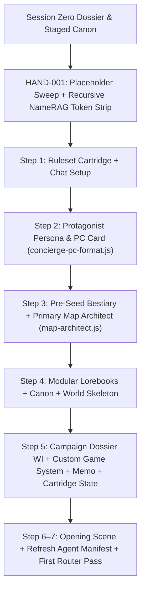

# Concierge to Framework Handoff — Architecture & Audit Hub

This folder documents the **handoff contracts and boundary guarantees** between the **Session Zero Concierge** (`MultiHogCompanion`) and the read-only upstream **`SillyTavern-MultihogDnDFramework`**.

While [docs/concierge/README.md](../concierge/README.md) covers Steps 1–4 inside the Session Zero workbench, this subsystem governs everything that happens **at and after Launch / Living-World Sync**: dossier sanitization, World Info / Canon / Bestiary / Location / Skeleton serialization, SillyTavern book registration, prefix derivation, Map Architect interop, and v3 Game System / Cartridge persistence.

---

## 1. Handoff Pipeline Overview

---

## 2. Documents in This Folder

* **[sanitization-and-lorebooks.md](./sanitization-and-lorebooks.md)** — Contracts for `HAND-001` (Universal Recursive NameRAG Token Sanitization), `HAND-002` (Canon Format, `[CORE]` Wrapping & Keyring Isolation), and `HAND-003` (Bestiary Format & SillyTavern World Info Registry / Activation).
* **[prefix-and-map-architect-interop.md](./prefix-and-map-architect-interop.md)** — Contracts for `HAND-004` (Canonical Campaign Prefix Resolution, Early Stamping & Wipe Hygiene) and `HAND-005` (Map Architect Private Prompt vs. Public `[CORE]` Brief & Mapped Site Preservation).
* **[cartridge-and-game-system-handoff.md](./cartridge-and-game-system-handoff.md)** — Contracts for `HAND-006` (`CompanionActiveCartridge` Metadata Preservation), `HAND-007` (Upstream v3 Custom Game System & Tracker Catalog Alignment), and `HAND-008` (`gameCartridges` Payload Completeness & D&D 5e Handoff Parity).
* **[memo-identity-and-heuristics.md](./memo-identity-and-heuristics.md)** — Contracts for `MEMO-001` (Entity Name/Archetype Splitting & Parenthetical Flattening), `MEMO-002` (FAE `Status:` Determinism), `MEMO-003` (Lossless `parseFaeStateFromMemo()` Round-Trip), `MEMO-004` (Sibling Brittle Regex Remediation), and `MEMO-005` (Regression Verification).

---

## 3. Active Audit & Remediation Tracker (`HAND-001` – `HAND-008`)

| ID | Phase | Finding / Contract Gap | Status | Target Files |
| :--- | :---: | :--- | :---: | :--- |
| **`HAND-001`** | **Phase 1** | Universal recursive stripping of `[NAME: ..., RESOLVED TO: ...]`, `[REALNAME: ...]`, `[concept: ...]`, and `[[NAME:...]]` across every dossier field, PC card, entity formatter, skeleton, and both Launch & Living-World Sync paths | **FIXED & VERIFIED** | [namerag-hooks.js](file:///var/home/dlittle/ai-stack/sillytavern-test/extensions/MultiHogCompanion/namerag-hooks.js), [concierge-runner.js](file:///var/home/dlittle/ai-stack/sillytavern-test/extensions/MultiHogCompanion/concierge-runner.js), [concierge-lore-distributor.js](file:///var/home/dlittle/ai-stack/sillytavern-test/extensions/MultiHogCompanion/concierge-lore-distributor.js), [concierge-npc-format.js](file:///var/home/dlittle/ai-stack/sillytavern-test/extensions/MultiHogCompanion/concierge-npc-format.js), [concierge-pc-format.js](file:///var/home/dlittle/ai-stack/sillytavern-test/extensions/MultiHogCompanion/concierge-pc-format.js) |
| **`HAND-002`** | **Phase 1** | `{prefix}_Canon` handoff contract: strip NameRAG tokens without mutating staged Session Zero badges, wrap bodies in `[CORE]...[/CORE]` for Router protection, and isolate disabled entries (`key: []`, `vectorized: false`, `canonKeys` backup) so upstream `scanAssistantOutputForKeywords()` never auto-activates excluded Canon | **FIXED & VERIFIED** | [concierge-canon.js](file:///var/home/dlittle/ai-stack/sillytavern-test/extensions/MultiHogCompanion/concierge-canon.js) |
| **`HAND-003`** | **Phase 1** | Normalize string vs. array `attacks` & `impendingDoom` in `buildMonsterEntryContent()`, and register/activate newly written World Info books in SillyTavern (`saveWorldInfo`, `updateWorldInfoList`, `/world state=on silent=true`) immediately so `loadWorldInfo()` & Turn 1 see `{prefix}_Bestiary` and sibling books without F5 | **FIXED & VERIFIED** | [concierge-npc-format.js](file:///var/home/dlittle/ai-stack/sillytavern-test/extensions/MultiHogCompanion/concierge-npc-format.js), [concierge-runner.js](file:///var/home/dlittle/ai-stack/sillytavern-test/extensions/MultiHogCompanion/concierge-runner.js) |
| **`HAND-004`** | **Phase 2** | Campaign prefix ordering (`renamedCampaignPrefix` vs. Steps 3/4/4b reads of `getEffectiveRouterCampaignPrefix`) & clean boundaries between `Campaign_{chatId}` and `{prefix}_*` books | **FIXED & VERIFIED** | [concierge-runner.js](file:///var/home/dlittle/ai-stack/sillytavern-test/extensions/MultiHogCompanion/concierge-runner.js) |
| **`HAND-005`** | **Phase 2** | Prevent Step 4 `{prefix}_Locations` upsert from clobbering Step 3 Map Architect `[CORE]` (`Host Site:` / `Host Brief:` / mapped-site description) and keep `threatContext` private to Map Architect's `prompt` | **FIXED & VERIFIED** | [concierge-runner.js](file:///var/home/dlittle/ai-stack/sillytavern-test/extensions/MultiHogCompanion/concierge-runner.js) |
| **`HAND-006`** | **Phase 3** | Preserve `customGenreSpec`, `stats`, `pools`, `knobs`, and `config` when stamping `CompanionActiveCartridge` in Step 5 & Living-World Sync | **FIXED & VERIFIED** | [concierge-runner.js](file:///var/home/dlittle/ai-stack/sillytavern-test/extensions/MultiHogCompanion/concierge-runner.js), [pbta-ruleset-persistence.js](file:///var/home/dlittle/ai-stack/sillytavern-test/extensions/MultiHogCompanion/pbta-ruleset-persistence.js) |
| **`HAND-007`** | **Phase 3** | Register Concierge Custom Game Systems via upstream v3 catalogs (`gameSystemDatabase`, `syspromptSnippetDatabase`, `trackerModuleDatabase`, `<tag>...</tag>` snippet wrapping, boolean driver flags, `syncChatSetupCatalogs`) and update in Living-World Sync | **FIXED & VERIFIED** | [concierge-runner.js](file:///var/home/dlittle/ai-stack/sillytavern-test/extensions/MultiHogCompanion/concierge-runner.js) |
| **`HAND-008`** | **Phase 3** | Align `gameCartridges` payload completeness and post-Step-5 refresh with upstream `CARTRIDGE_PAYLOAD_GROUPS` & `applyChatSetup` across PbtA, FAE, and D&D 5e | **FIXED & VERIFIED** | [concierge-runner.js](file:///var/home/dlittle/ai-stack/sillytavern-test/extensions/MultiHogCompanion/concierge-runner.js), [pbta-ruleset.js](file:///var/home/dlittle/ai-stack/sillytavern-test/extensions/MultiHogCompanion/pbta-ruleset.js), [fae-ruleset.js](file:///var/home/dlittle/ai-stack/sillytavern-test/extensions/MultiHogCompanion/fae-ruleset.js) |
| **`MEMO-001`** | **Memo Audit** | Split embedded parenthetical archetypes out of protagonist names via depth-balanced parsing and flatten nested parens across parser, FAE/PbtA/D&D 5e memo formatters, and Stage 4 prompt | **FIXED & VERIFIED** | [character-creator-sanitizer.js](file:///var/home/dlittle/ai-stack/sillytavern-test/extensions/MultiHogCompanion/character-creator-sanitizer.js), [concierge-parser.js](file:///var/home/dlittle/ai-stack/sillytavern-test/extensions/MultiHogCompanion/concierge-parser.js), [fae-state-sync.js](file:///var/home/dlittle/ai-stack/sillytavern-test/extensions/MultiHogCompanion/fae-state-sync.js), [pbta-ruleset.js](file:///var/home/dlittle/ai-stack/sillytavern-test/extensions/MultiHogCompanion/pbta-ruleset.js), [concierge-system-dnd5e.js](file:///var/home/dlittle/ai-stack/sillytavern-test/extensions/MultiHogCompanion/concierge-system-dnd5e.js), [concierge-prompt.js](file:///var/home/dlittle/ai-stack/sillytavern-test/extensions/MultiHogCompanion/concierge-prompt.js) |
| **`MEMO-002`** | **Memo Audit** | Remove FAE `rawNegTags.length > 0 -> '(-) Strained & Injured'` status-guessing heuristic in favor of deterministic breaking-point / persisted `char.status` / `'Healthy'` precedence | **FIXED & VERIFIED** | [fae-state-sync.js](file:///var/home/dlittle/ai-stack/sillytavern-test/extensions/MultiHogCompanion/fae-state-sync.js) |
| **`MEMO-003`** | **Memo Audit** | Harden `parseFaeStateFromMemo()` for balanced nested-paren Line-1 headers, `Status:` persistence into `character.status`, and respecting explicit `Positive Tags: None` without genre backfill | **FIXED & VERIFIED** | [fae-state-sync.js](file:///var/home/dlittle/ai-stack/sillytavern-test/extensions/MultiHogCompanion/fae-state-sync.js) |
| **`MEMO-004`** | **Memo Audit** | Scope `[CHARACTER]` placeholder replacement strictly to Line 1 (`sanitizeCharacterHeaderInMemo()` / `rectifyMemoCharacterName()`), balance `normalizeFaePill()` trailing parens, and replace naive companion substring matching with negation-aware `isAlliedCompanionRole()` | **FIXED & VERIFIED** | [character-creator-sanitizer.js](file:///var/home/dlittle/ai-stack/sillytavern-test/extensions/MultiHogCompanion/character-creator-sanitizer.js), [fae-state-sync.js](file:///var/home/dlittle/ai-stack/sillytavern-test/extensions/MultiHogCompanion/fae-state-sync.js), [pbta-ruleset.js](file:///var/home/dlittle/ai-stack/sillytavern-test/extensions/MultiHogCompanion/pbta-ruleset.js), [concierge-runner.js](file:///var/home/dlittle/ai-stack/sillytavern-test/extensions/MultiHogCompanion/concierge-runner.js) |
| **`MEMO-005`** | **Memo Audit** | Document `MEMO-001`–`MEMO-004` contracts and lock in deterministic regression tests covering Turn-0 FAE/PbtA/D&D identity formatting, lossless round-tripping, and sibling regex fixes | **FIXED & VERIFIED** | [memo-identity-and-heuristics.md](file:///var/home/dlittle/ai-stack/sillytavern-test/extensions/MultiHogCompanion/docs/handoff/memo-identity-and-heuristics.md), [memo-upstream-contract.test.js](file:///var/home/dlittle/ai-stack/sillytavern-test/extensions/MultiHogCompanion/tests/memo-upstream-contract.test.js) |
