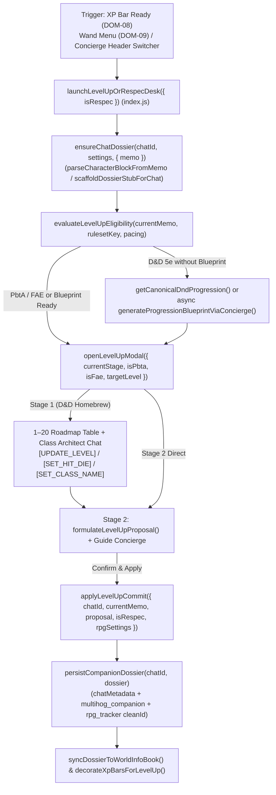

# MultiHog Companion — Character & Level-Up / Respec Desk Contracts

> **Purpose:** This folder documents the **executable architectural contracts** governing the Autonomous Level-Up Concierge & Class Progression Codex (`FEAT-10`), turn-0 / quick-start character scaffolding, multi-engine advancement proposals, surgical state memo commits, and the Two-Stage Level-Up / Respec UI.  
> It applies the same contract-driven methodology as [docs/concierge/README.md](../concierge/README.md) and [docs/cartridges/README.md](../cartridges/README.md) so prompt contracts, state parsing, persistence partitions, and UI controls stay synchronized across D&D 5e Lite, PbtA, and FAE.

---

## 1. Document Map (Level-Up & Respec Contracts)

| Phase / Document | Scope & Owned Subsystem | Primary Source Files |
| :--- | :--- | :--- |
| **[codex-and-scaffolding.md](codex-and-scaffolding.md)** | 1–20 Class Progression Codex (`CORE_DND_PROGRESSIONS`), `formatTraitAsPill()`, dual-block routing (`[CHARACTER] Traits:` vs `[ABILITIES]`), homebrew blueprint compiler, FAE/PbtA/D&D memo scaffolding, `WRK-10` partition persistence, and `launchLevelUpOrRespecDesk()` (`LVL-001`, `LVL-002`, `LVL-008`) | `level-up-blueprint.js`, `level-up-scaffold.js`, `index.js` |
| **[runner-and-commit-engine.md](runner-and-commit-engine.md)** | Deterministic XP / Scenes eligibility evaluation, `formulateLevelUpProposal()`, `PBTA_ADVANCE_CATALOG` & `FAE_MILESTONE_CATALOG`, `buildFaeMilestonePrompt()`, `extractConciergeDirectives()`, `applyLevelUpCommit()`, and `applyDossierCommitUpdate()` (`LVL-003`, `LVL-004`, `LVL-005`) | `level-up-runner.js`, `level-up-ui.js` |
| **[modal-ui-and-progression-architect.md](modal-ui-and-progression-architect.md)** | Stage 1/2 split-pane modal (`buildLevelUpModalHtml()`, `openLevelUpModal()`), `normalizeFaeOverflowRule()`, interactive Concierge chat directives, and in-drawer `renderProgressionArchitect()` (`LVL-006`, `LVL-007`) | `level-up-stage-renderers.js`, `level-up-ui.js`, `progression-architect-ui.js` |

*(See also: [ORIENTATION.md](../ORIENTATION.md), [FEATURES.md](../../FEATURES.md#feat-10-autonomous-level-up-concierge--class-progression-codex), and [upstream-multihog.md](../upstream-multihog.md).)*

---

## 2. Three-Engine Advancement & Tuning Comparison Matrix

| Dimension | **D&D 5e Lite (`FEAT-10`)** | **Powered by the Apocalypse (PbtA)** | **Freeform Attrition Engine (FAE)** |
| :--- | :--- | :--- | :--- |
| **Trigger Metric & Threshold** | `XP >= threshold` (`XP_LEVEL_THRESHOLDS`, cap Level 20) via `evaluateLevelUpEligibility()` | `XP >= pacingXp` (default `5/5`) roll-over bucket | `Scenes >= scenes_target` (default `4/4`) scene milestone counter |
| **Stage 1: 1–20 Progression Codex** | Active (editable 4-tier roadmap, SRD presets in `CORE_DND_PROGRESSIONS` or async Concierge JSON generation) | Bypassed (`progressionBlueprint = null`; straight to Stage 2) | Bypassed (`progressionBlueprint = null`; straight to Stage 2) |
| **Advancement Choices** | Average vs Rolled HP (`HitDie + CON mod`), ASI (`+2` / `+1,+1`) or Feat on milestones, Spell Slot growth, lockstep `[PARTY]` sync | `PBTA_ADVANCE_CATALOG`: `+1 Stat` (cap 2), `Playbook Move` (cap 4), `Cross-Playbook Move` (cap 2), `+1 Max Harm` (cap 1), `+1 Armor` (cap 1) | `FAE_MILESTONE_CATALOG`: `heal_scar` (remove scar or restore +1 lost pool max), `new_capability` (`Trait [context]` qualification), `hardened_reserve` (+1 pool max up to 12) |
| **Sheet Block Commit Targets** | `[CHARACTER]` (Level, HP, HD, ASI, `Traits:`), `[ABILITIES]`, `[SPELLS]`, `[XP]`, `[PARTY]` | `[CHARACTER]` (Tandem `HP/Harm`, `Armor`, `Stats:`, `((PILLS)) Moves:`, `XP`) + `protagonist.moves` | `[CHARACTER]` (rebuilt via `formatFaeCharacterMemoBlock()`: primary/secondary pools, `FAE Knobs:`, `Positive Tags:`, `Scars & Debuffs:`, `Scenes`) |
| **Upstream Suppression** | Forces `syspromptModules.level_up_protocol = false` in `cleanseStockDndSettings()` & `installCartridge()` | Uses Companion PbtA cart (`lvl`/XP blocks suppressed) | Uses Companion FAE cart (`xp: false`, milestone pacing) |

---

## 3. End-to-End Level-Up & Respec Lifecycle

---

## 4. Standard 9-Section Level-Up & Respec Contract Template

Every contract document under `docs/level-up/` uses these 9 sections:
1. **Subsystem Purpose & Ownership Boundary** — Responsibilities and strict boundary with read-only upstream `SillyTavern-MultihogDnDFramework/`.
2. **Data Model & Schema Contract** — Canonical fields, default values, noise filters, and ruleset variations (`dnd5e`, `pbta`, `fae`).
3. **Formatting, Classification & Rendering Syntax** — Pill hover-tooltip grammar, resource counters, and HTML/Markdown serialization contracts.
4. **Prompt & Directive Parsing Contract** — Concierge system prompts, bracket-depth scanners, and fallback behavior.
5. **Multi-Engine Resolution & Scaffolding Contract** — Priority order across live memos, chat metadata, and partition caches.
6. **Persistence & `WRK-10` Key Sanitization Contract** — Partition synchronization rules across `chatStates`, `chatMetadata`, and World Info lorebooks.
7. **UI Orchestration & Modal Transitions** — Button gating, shimmer/async promise resolution, and mode-switcher state preservation.
8. **Failure Modes, Guardrails & Audit Fixes (`LVL-XXX`)** — Known hazards, graceful fallbacks, and remediated defects.
9. **Code Anchors & Test Coverage** — Canonical function names, catalog IDs (`FEAT-10`, `WRK-08`, `WRK-10`, `DOM-08`, `DOM-09`), and test files.

---

## 5. Active Level-Up & Respec Audit Tracker (`LVL-001` – `LVL-008`)

| Audit ID | Status | Severity | Summary of Defect & Fix / Planned Action | Verified By |
| :--- | :--- | :--- | :--- | :--- |
| **`LVL-001`** | **Fixed (Phase 1)** | **High** | `launchLevelUpOrRespecDesk()` in `index.js` overwrote FAE `dossier.meta.systemKey = 'fae'`, erasing active genre keys (`'osr_dungeon'`, `'survival_horror'`, `'custom'`), and omitted `pacingScenes` (`scenesTarget`) in `evaluateLevelUpEligibility()`. Preserved valid FAE `systemKey` (defaulting via `detectActiveFaeGenre()` only when unset/generic) and forwarded `pacingScenes`. | `tests/level-up-system.test.js` |
| **`LVL-002`** | **Fixed (Phase 1)** | **High** | `parseCharacterBlockFromMemo()`, `scaffoldDossierStubForChat()`, `ensureChatDossier()`, and `syncDossierToWorldInfoBook()` in `level-up-scaffold.js` only handled `pbta` vs `dnd5e` — mistreating FAE quick-start chats as D&D 5e (`hitDie: 'd8'`, linking `CORE_DND_PROGRESSIONS` when archetype matched `'Ranger'`) and writing D&D `Level`/`Hit Points`/`Hit Die` lines into PbtA/FAE lorebook entries. Added `isDossierFae()`, full FAE parsing/scaffolding via `parseFaeStateFromMemo()`, `progressionBlueprint = null` enforcement, and `buildDossierWorldInfoMarkdown()` per-ruleset formatting. | `tests/level-up-system.test.js` |
| **`LVL-003`** | **Fixed (Phase 2)** | **High** | `resolvePbtaGenreKey()`, `getCanonicalPbtaStats()`, `buildPbtaAdvanceOptions()`, and `formulateLevelUpProposal()` in `level-up-runner.js` indexed raw `PBTA_GENRES` instead of `resolveEffectivePbtaGenre()`, ignoring `customGenreSpec` stats & moves. Routed PbtA genre detection, stat normalization, and move template expansion through `resolveEffectivePbtaGenre()` with `custom` genre preservation. | `tests/level-up-system.test.js` |
| **`LVL-004`** | **Fixed (Phase 2)** | **Medium** | `resolveFaeGenreKey()`, `buildFaeMilestoneOptions()`, and `formulateLevelUpProposal()` in `level-up-runner.js` ignored `resolveEffectiveFaeGenre()` custom pools/tags, `dossier.character`, and `scenesTarget`. Added `resolveEffectiveFaeGenre()` + `normalizeCustomFaePools()` support, Turn-0 `dossier.character` fallbacks, `scenesTarget` commit persistence, and PbtA genre-collision guards. | `tests/level-up-system.test.js` |
| **`LVL-005`** | **Fixed (Phase 2)** | **High** | `applyLevelUpCommit()` (`level-up-runner.js`) and Confirm handler (`level-up-ui.js`) updated `protagonist.moves` without updating `protagonist.startingMoves`/`armor` on PbtA advance, incremented raw D&D ASI scores without recalculating parenthetical modifiers, and did not sync D&D partition dossiers via `setPartitionDossier()`. Added modifier-aware `applyAsiStatBump()`, `applyAsiToStatsMap()`, shared `applyDossierCommitUpdate()`, `Armor:` injection, and double-apply guards. | `tests/level-up-system.test.js` |
| **`LVL-006`** | **Fixed (Phase 3)** | **Medium** | `buildFaeMilestoneAndTuningHtml()` (`level-up-stage-renderers.js`) inverted FAE `base_attrition_shift` labels (`-1` vs `+1`) and offered unrecognized `gear_loss`/`narrative_fail` overflow options (falling through to `OVERFLOW_LETHAL`). Fixed `-1 (Pulp / Forgiving Attrition)` vs `+1 (Brutal / Heavy Attrition)`, replaced invalid options with canonical `scene_fail`, and shared `normalizeFaeOverflowRule()` with `level-up-ui.js` `SET_KNOB` directive handling. | `tests/level-up-system.test.js` |
| **`LVL-007`** | **Fixed (Phase 3)** | **Low** | `progression-architect-ui.js` ignored `resolveEffectivePbtaGenre()`/`resolveEffectiveFaeGenre()`, `blueprintMatchesClass()`, Turn-0 `dossier.character`, custom `pacingXp`, and custom `scenesTarget`. Updated D&D/PbtA/FAE renderers to honor custom genres, `dossier.character` fallbacks, canonical stat pills, negative scars, and custom pacing triggers. | `tests/concierge-progression-codex.test.js` |
| **`LVL-008`** | **Fixed (Phase 1)** | **Medium** | `ensureChatDossier()` and `persistCompanionDossier()` in `level-up-scaffold.js` ignored `SillyTavern.getContext().extensionSettings` and wrote only `.companionDossier` without `setPartitionDossier()`. Added `ctx.extensionSettings` fallback and `setPartitionDossier()` sync while preserving `WRK-10` `.jsonl` key stripping (`cleanId`). | `tests/level-up-system.test.js` |
